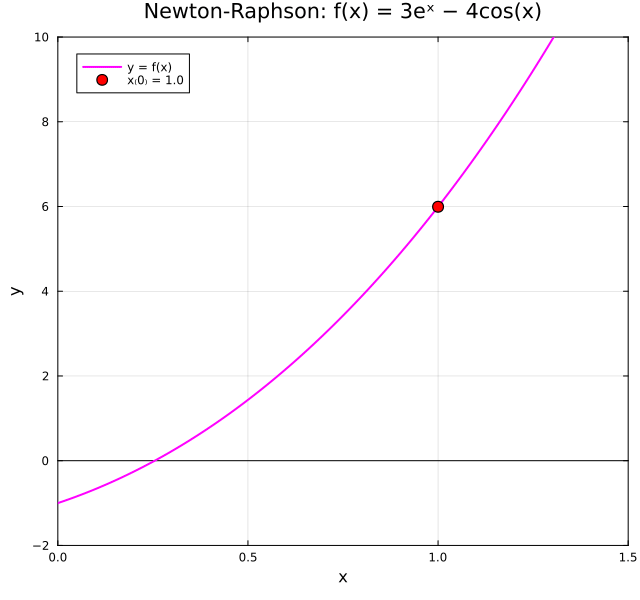
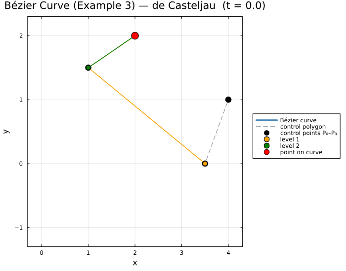
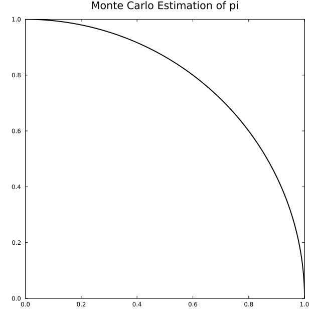

::::: {.landing}

::: {.landing-intro}

You can find the source code at [https://github.com/jasonnicholson/jasonnicholson.github.io](https://github.com/jasonnicholson/jasonnicholson.github.io). If the domain is ever lost or not working, [https://jasonnicholson.github.io](https://jasonnicholson.github.io) should still work.
:::

:::: {.landing-stats}
::: {.stat}
[110+]{.stat-num} [numerical-methods pages]{.stat-label}
:::
::: {.stat}
[400+]{.stat-num} [animations]{.stat-label}
:::
::: {.stat}
[50+]{.stat-num} [blog posts since 2015]{.stat-label}
:::
::: {.stat}
[12]{.stat-num} [regularizeNd tutorials & articles]{.stat-label}
:::
::::

Looking for one specific method? Use the search in the top bar (press [/]{.kbd}).

## Where do you want to go? {.landing-h}

:::: {.landing-grid .cols-2}

::: {.door}
### [[]{.bi .bi-graph-up} Numerical Methods](pages/numerical-methods/index.qmd)

Short explanations, fully worked examples, and animations for root finding, linear systems, interpolation, integration, differential equations, eigenvalues, and optimization. Inspired by John H. Mathews' numerical analysis site.

[Popular:]{.door-label} [Newton-Raphson](pages/numerical-methods/newton-raphson-method/) · [Cubic Splines](pages/numerical-methods/cubic-splines/) · [Runge-Kutta](pages/numerical-methods/runge-kutta-method/) · [Gauss-Legendre](pages/numerical-methods/gauss-legendre-quadrature/)

[Browse by chapter ↓](#numerical-methods-chapters){.door-cta}
:::

::: {.door}
### [[]{.bi .bi-grid-3x3} regularizeNd](pages/regularizeNd/index.qmd)

A MATLAB function that fits a smooth, gridded surface to scattered data in any number of dimensions. Learn to use it from a tutorial series, or learn how it works from the foundation pages and a deep-dive article.

[Start:]{.door-label} [Part 1: Introduction](pages/regularizeNd/part-01-introduction-and-intuition.qmd) · [Foundations](pages/regularizeNd/foundations-2d-data.qmd) · [Deep dive](pages/regularizeNd/deep-dive-regularizeNd-design.qmd) · [Download](https://www.mathworks.com/matlabcentral/fileexchange/61436-regularizend)

[All 12 pages →](pages/regularizeNd/index.qmd){.door-cta}
:::

::: {.door}
### [[]{.bi .bi-journal-text} Blog](blog.qmd)

Notes from a decade of engineering work: numerical math and optimization, CFD and FEA simulation, controls, programming, and building workstations and toolchains.

[Topics:]{.door-label} [Math](blog.qmd#category=math) · [Simulation](blog.qmd#category=simulation) · [Programming](blog.qmd#category=programming) · [DevOps](blog.qmd#category=devOps)

[Latest posts ↓](#latest){.door-cta}
:::

::: {.door}
### [[]{.bi .bi-tools} Tools & Resources]{.door-title-plain}

[**Secant/Muller Inverse Solver**](pages/calculators/secant-muller-inverse-solver/). An interactive calculator that solves f(x) = target in your browser. [More calculators](pages/calculators/index.qmd).

[**System Identification**](pages/system-identification/index.qmd). A curated list of books, courses, and researchers for learning system identification.
:::

::::

## Numerical Methods by chapter {#numerical-methods-chapters .landing-h}

Every page explains a method and works an example by hand, and most animate it.

:::: {.landing-gallery}
[{loading="lazy" fig-alt="Animation of Newton-Raphson tangent-line iterations converging to a root"}[Newton-Raphson]{.gallery-caption}](pages/numerical-methods/newton-raphson-method/)
[{loading="lazy" fig-alt="Animation of the de Casteljau construction tracing a Bézier curve"}[Bézier Curves]{.gallery-caption}](pages/numerical-methods/bezier-curves/)
[{loading="lazy" fig-alt="Animation of least-squares polynomial fits of increasing degree"}[Least Squares Polynomials]{.gallery-caption}](pages/numerical-methods/least-squares-polynomials/)
[{loading="lazy" fig-alt="Animation of a Fourier series approximation"}[Fourier Series]{.gallery-caption}](pages/numerical-methods/fourier-series/)
[{loading="lazy" fig-alt="Animation of the RK4 method stepping along an ODE solution"}[Runge-Kutta]{.gallery-caption}](pages/numerical-methods/runge-kutta-method/)
[{loading="lazy" fig-alt="Animation of random points estimating pi inside a quarter circle"}[Monte Carlo Pi]{.gallery-caption}](pages/numerical-methods/monte-carlo-pi/)
::::

:::: {.landing-grid .cols-3}

::: {.chapter}
#### [Fundamentals](pages/numerical-methods/index.qmd#fundamentals) [start here]{.chapter-count}
[Big "O" Truncation Error](pages/numerical-methods/big-o-truncation-error/): how the error of a method shrinks as the step size shrinks. The rest of the chapters use this idea.
:::

::: {.chapter}
#### [Nonlinear Equations f(x) = 0](pages/numerical-methods/index.qmd#the-solution-of-nonlinear-equations-fx-0) [17]{.chapter-count}
[Bisection](pages/numerical-methods/bisection-method/) · [Newton-Raphson](pages/numerical-methods/newton-raphson-method/) · [Secant](pages/numerical-methods/secant-method/) · [Brent's](pages/numerical-methods/brents-method/) · [Broyden's](pages/numerical-methods/broydens-method/)
:::

::: {.chapter}
#### [Linear Systems AX = B](pages/numerical-methods/index.qmd#the-solution-of-linear-systems-ax-b) [15]{.chapter-count}
[Gauss-Jordan](pages/numerical-methods/gauss-jordan-elimination-and-pivoting.qmd) · [LU Factorization](pages/numerical-methods/lu-factorization.qmd) · [Jacobi & Gauss-Seidel](pages/numerical-methods/jacobi-and-gauss-seidel-iteration/) · [SOR](pages/numerical-methods/successive-over-relaxation-sor/) · [Simplex](pages/numerical-methods/linear-programming-simplex-method/)
:::

::: {.chapter}
#### [Function Approximation](pages/numerical-methods/index.qmd#function-approximation) [17]{.chapter-count}
[Taylor Series](pages/numerical-methods/maclaurin-and-taylor-series/) · [Padé](pages/numerical-methods/pade-approximation/) · [Lagrange](pages/numerical-methods/lagrange-polynomial-interpolation-and-approximation/) · [Cubic Splines](pages/numerical-methods/cubic-splines/) · [Chebyshev](pages/numerical-methods/chebyshev-approximation-polynomial/)
:::

::: {.chapter}
#### [Curve Fitting](pages/numerical-methods/index.qmd#curve-fitting) [8]{.chapter-count}
[Least Squares Lines](pages/numerical-methods/least-squares-lines/) · [Least Squares Polynomials](pages/numerical-methods/least-squares-polynomials/) · [Nonlinear Curve Fitting](pages/numerical-methods/nonlinear-curve-fitting/) · [Logistic Curve](pages/numerical-methods/logistic-curve/)
:::

::: {.chapter}
#### [Numerical Differentiation](pages/numerical-methods/index.qmd#numerical-differentiation) [3]{.chapter-count}
[Difference Formulas](pages/numerical-methods/numerical-differentiation/) · [Richardson Extrapolation](pages/numerical-methods/richardson-extrapolation/) · [Deriving Formulae](pages/numerical-methods/derive-numerical-differentiation-formulae/)
:::

::: {.chapter}
#### [Numerical Integration](pages/numerical-methods/index.qmd#numerical-integration) [14]{.chapter-count}
[Trapezoidal](pages/numerical-methods/trapezoidal-rule-for-numerical-integration/) · [Simpson's](pages/numerical-methods/simpsons-rule-for-numerical-integration/) · [Romberg](pages/numerical-methods/romberg-integration/) · [Gauss-Legendre](pages/numerical-methods/gauss-legendre-quadrature/) · [Monte Carlo](pages/numerical-methods/monte-carlo-integration/)
:::

::: {.chapter}
#### [Ordinary Differential Equations](pages/numerical-methods/index.qmd#solution-of-differential-equations) [21]{.chapter-count}
[Euler's](pages/numerical-methods/eulers-method-for-odes/) · [Runge-Kutta](pages/numerical-methods/runge-kutta-method/) · [Runge-Kutta-Fehlberg](pages/numerical-methods/runge-kutta-fehlberg-method/) · [Adams-Bashforth-Moulton](pages/numerical-methods/adams-bashforth-moulton-method/) · [Shooting](pages/numerical-methods/shooting-methods-for-odes/)
:::

::: {.chapter}
#### [Partial Differential Equations](pages/numerical-methods/index.qmd#solution-of-partial-differential-equations) [3]{.chapter-count}
[Finite Difference](pages/numerical-methods/finite-difference-method/) · [Crank-Nicolson](pages/numerical-methods/crank-nicolson-method/) · [Elliptic PDEs](pages/numerical-methods/elliptic-pdes/)
:::

::: {.chapter}
#### [Eigenvalues & Eigenvectors](pages/numerical-methods/index.qmd#eigenvalues-and-eigenvectors) [10]{.chapter-count}
[Power Method](pages/numerical-methods/power-method/) · [Jacobi Method](pages/numerical-methods/jacobi-method/) · [QR Method](pages/numerical-methods/qr-method/) · [Householder](pages/numerical-methods/householder-transformations.qmd) · [Matrix Exponential](pages/numerical-methods/matrix-exponential/)
:::

::: {.chapter}
#### [Optimization](pages/numerical-methods/index.qmd#numerical-optimization) [7]{.chapter-count}
[Golden Ratio Search](pages/numerical-methods/golden-ratio-search/) · [Nelder-Mead](pages/numerical-methods/nelder-mead-method/) · [Powell's](pages/numerical-methods/powells-method/) · [Steepest Descent](pages/numerical-methods/steepest-descent-gradient-search/) · [Newton's Search](pages/numerical-methods/newtons-search-method/)
:::

::: {.chapter}
#### Applied Models [across chapters]{.chapter-count}
[Pendulum](pages/numerical-methods/pendulum/) · [Projectile Motion](pages/numerical-methods/projectile-motion/) · [Lorenz Attractor](pages/numerical-methods/lorenz-attractor/) · [Lotka-Volterra](pages/numerical-methods/lotka-volterra-model/) · [Spring-Mass](pages/numerical-methods/spring-mass-systems/) · [Kirchhoff's Law](pages/numerical-methods/kirchhoffs-law.qmd) · [Earthquake Model](pages/numerical-methods/earthquake-model/)
:::

::::

## Latest from the blog {#latest .landing-h}

[Browse by topic:]{.door-label} [Math](blog.qmd#category=math){.topic-chip} [Optimization](blog.qmd#category=optimization){.topic-chip} [MATLAB](blog.qmd#category=MATLAB){.topic-chip} [Simulation](blog.qmd#category=simulation){.topic-chip} [CFD](blog.qmd#category=CFD){.topic-chip} [FEA](blog.qmd#category=FEA){.topic-chip} [CAE](blog.qmd#category=CAE){.topic-chip} [Controls](blog.qmd#category=controls){.topic-chip} [System ID](blog.qmd#category=system-identification){.topic-chip} [Programming](blog.qmd#category=programming){.topic-chip} [DevOps](blog.qmd#category=devOps){.topic-chip} [Computing](blog.qmd#category=computing){.topic-chip} [Video](blog.qmd#category=video){.topic-chip} [Running](blog.qmd#category=running){.topic-chip}

::: {#latest-posts}
:::

[All posts →](blog.qmd){.door-cta}

::: {.landing-footer}
[About me](about.qmd) · [Contact](contact.qmd) · [Source code on GitHub](https://github.com/jasonnicholson/jasonnicholson.github.io)
:::

:::::
