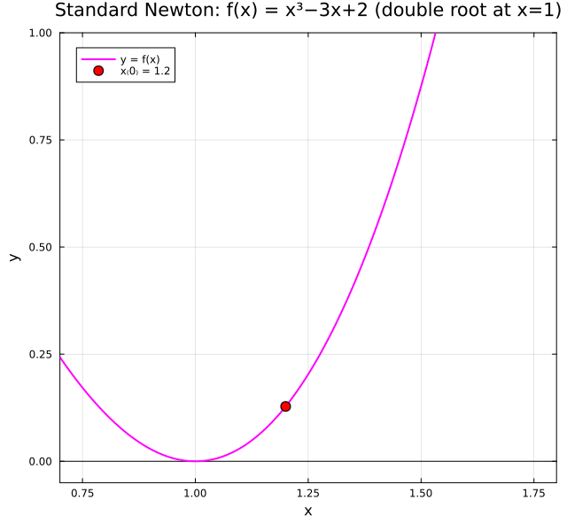
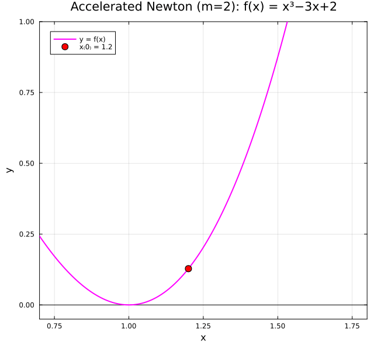

← [Numerical Methods](../)

Source inspiration: [@mathewsSite].

## Description

Standard Newton-Raphson converges **quadratically** at simple roots but degrades to **linear** convergence at multiple roots, because $f'(x^*) = 0$ there. Two methods restore quadratic convergence.

**Accelerated Newton-Raphson (Method A)** multiplies the Newton step by the known root multiplicity $m$:
$$x_{n+1} = x_n - m \cdot \frac{f(x_n)}{f'(x_n)}$$
This compensates for the vanishing derivative and recovers the quadratic rate. It requires knowing $m$ in advance.

**Modified Newton-Raphson (Method B)** avoids needing $m$ by reformulating the problem. If $f$ has a root of multiplicity $m$ at $x^*$, then $h(x) = f(x)/f'(x)$ has a **simple** root at $x^*$. Applying Newton's method to $h$ gives:
$$x_{n+1} = x_n - \frac{f(x_n)\,f'(x_n)}{f'(x_n)^2 - f(x_n)\,f''(x_n)}$$
This also converges quadratically, without knowing $m$.

Both methods require that $f$ be sufficiently smooth near the root and that the starting point $x_0$ be close enough to $x^*$.

## Animations

Each animation below shows a Newton-style line diagram for three methods applied to the same double root. At each iterate $x_n$, the line from the plotted curve at $x_n$ to the x-axis intercept traces the next approximation $x_{n+1}$. In Cases 1 and 3 that line is the tangent to the plotted curve; in Case 2 it has half the tangent slope (see Case 2). Cases 1 and 2 both plot $f(x)$; Case 3 plots $h(x) = f(x)/f'(x)$, which has a *simple* root where $f$ has a double root.

Julia source scripts that generated these animations are linked under each case.

The three cases reproduce Examples 1(b), 2 and 4 of Mathews' Accelerated and Modified Newton Methods module, all at the double root of the same cubic.
The module's Examples 1(a), 3, 5 and 6, which apply standard Newton-Raphson at the simple root of that cubic (Example 1(a)), the accelerated method (Example 3) and the modified method (Example 5) at a double and a triple root of a fifth-degree polynomial, and the standard, accelerated and modified methods at a root of higher multiplicity (Example 6), are not animated here.

### Case 1 — Standard Newton-Raphson, linear convergence, $f(x) = x^3 - 3x + 2$, $x_0 = 1.2$

**Behavior:** $f(x) = (x-1)^2(x+2)$ has a double root at $x^* = 1$. Because $f'(x^*) = 0$ at a multiple root, the asymptotic error constant is $(m-1)/m = 1/2$, meaning each step only halves the error. Near the root $f(x) \approx 3(x-1)^2$, so the tangent at $x_n$ meets the axis between $x_n$ and $x^*$, only about halfway there ($x_{n+1} - 1 \approx (x_n - 1)/2$). Each step covers just under half the remaining distance (1.2, 1.10303, 1.052356, 1.026401, …), so after 12 steps $x_{12} = 1.000052$ is still about $5.2 \times 10^{-5}$ from the root. At the scale of the plot only the first few steps can be told apart: from $x_5$ on, the iterate is less than 0.007 from the root and its marker covers the root, so the remaining halvings show only in the legend value.

[Julia source](accnewtonaa.jl)

### Case 2 — Accelerated Newton-Raphson (Method A, $m=2$), quadratic convergence, $f(x) = x^3 - 3x + 2$, $x_0 = 1.2$

**Behavior:** The accelerated formula $x_{n+1} = x_n - m \cdot \tfrac{f(x_n)}{f'(x_n)}$ with $m = 2$ enlarges each Newton step by the known multiplicity, compensating for the vanishing derivative at the double root. The orange line from $(x_n,\, f(x_n))$ is therefore not the tangent: its slope is $f'(x_n)/2$, half the tangent slope, so it meets the axis twice as far from $x_n$ as the Newton tangent would. This restores quadratic convergence: $|e_{n+1}| \approx C |e_n|^2$. From the same starting point as Case 1, $x_1 = 1.006061$, $x_2 = 1.000006$, and $x_3$ equals 1 to six decimals. **Requires knowing $m$ in advance.**

[Julia source](accnewtonbb.jl)

### Case 3 — Modified Newton-Raphson (Method B), quadratic convergence, $f(x) = x^3 - 3x + 2$, $x_0 = 1.2$

**Behavior:** Define $h(x) = f(x)/f'(x)$. At a double root of $f$, $h$ has a **simple** root — so standard Newton on $h$ gives quadratic convergence. The iteration formula
$$x_{n+1} = x_n - \frac{f(x_n)\,f'(x_n)}{f'(x_n)^2 - f(x_n)\,f''(x_n)}$$
implements Newton on $h(x)$ using $f$, $f'$, and $f''$ directly. The animation plots $h(x) = (x-1)(x+2)/(3(x+1))$ with the tangent lines dashed. $h$ is nearly straight between the root and $x_0$, so the first tangent lies almost on the curve and takes the iterate in one step to $x_1 = 0.994152$, just left of the root. At this scale that overshoot and the later steps are too small to see, and the iterates are read from the legend: $x_2 = 0.999994$, and, as in Case 2, $x_3$ equals 1 to six decimals. **Does not require knowing $m$.**

[Julia source](accnewtoncc.jl)

