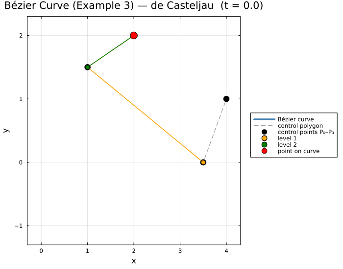

← [Numerical Methods](../)

Source inspiration: [@mathewsSite].

## Description

A Bézier curve solves a design problem, not an equation: it draws a smooth curve between two endpoints, shaped by control points that it does not, in general, pass through.
With control points $P_0,\ldots,P_n$, the degree-$n$ curve is the Bernstein polynomial form

$$
B(t)=\sum_{i=0}^{n}\binom{n}{i}(1-t)^{n-i}t^iP_i,\qquad t\in[0,1].
$$

Mathews writes the cubic, with $P_i=(x_i,y_i)$, in powers of $t$; expanding the Bernstein form gives the same:

$$
x(t)=x_0+3t\,(x_1-x_0)+3t^2\,(x_0+x_2-2x_1)+t^3\,(x_3-x_0+3x_1-3x_2),
$$

and the same with $y$ in place of $x$.
The animations evaluate the curve by the de Casteljau algorithm, which repeatedly interpolates linearly between adjacent points until one point remains:

$$
P_i^{(0)}=P_i,\qquad P_i^{(k)}(t)=(1-t)\,P_i^{(k-1)}(t)+t\,P_{i+1}^{(k-1)}(t),\qquad B(t)=P_0^{(n)}(t).
$$

Orange points are level 1, green level 2, and red is $B(t)$.
At $t=1/2$ in [Case 1](#case-1), the levels are $(3/2,7/4)$, $(9/4,3/4)$, $(15/4,1/2)$, then $(15/8,5/4)$, $(3,5/8)$, and finally $B(1/2)=(39/16,15/16)$.

The construction needs only the control points and $t\in[0,1]$; there is no smoothness hypothesis.
In general, the curve starts at $P_0$, ends at $P_n$, and is tangent there to its handles: $B'(0)=n(P_1-P_0)$ and $B'(1)=n(P_n-P_{n-1})$.
The Bernstein weights are nonnegative and sum to 1, so the curve stays inside the convex hull of its control points, and the segment joining the two level-$(n-1)$ points (green) is tangent to it: $B'(t)=n\bigl(P_1^{(n-1)}(t)-P_0^{(n-1)}(t)\bigr)$.

The curve is exactly the polynomial its control points define, so there is no truncation error, only rounding error.
For $0\le t\le 1$ every de Casteljau step is a convex combination, and in general its rounding error is at most a multiple, growing linearly with $n$, of the unit roundoff times the size of the control points.
Mathews' power form is cheaper with [Horner's method](../horners-method.qmd), $O(n)$ operations against $O(n^2)$, but at high degree its coefficients can grow far larger than the control points and cancel, losing accuracy; for the cubics on this page both forms are accurate to about $10^{-15}$.

Two features mislead readers expecting interpolation.
The curve misses its handles: in Case 1 it passes no closer than 0.78 to $P_1$ and 0.67 to $P_2$.
And control is global: every Bernstein weight is positive for $0<t<1$, so moving one interior control point moves every point of the curve except the two ends.
[Case 2](#case-2) doubles the handle lengths of Case 1, and the whole curve shifts, its leftmost point moving from $x\approx 1.77$ to $x\approx 1.33$.

A cubic Bézier curve is the [Hermite](../hermite-polynomial-interpolation/) clamped cubic with end values $P_0$, $P_3$ and end derivatives $3(P_1-P_0)$, $3(P_3-P_2)$; [B-Splines](../b-splines/) join pieces with local control, while [Cubic Splines](../cubic-splines/) and [Lagrange interpolation](../lagrange-polynomial-interpolation-and-approximation/) pass through every given point.

## Animations

Each animation below demonstrates the **de Casteljau algorithm** for constructing a cubic Bézier curve. At parameter $t$, the algorithm recursively linearly interpolates between adjacent control points through three successive levels until a single point on the curve is reached. Tracing this point for all $t \in [0,1]$ draws the full curve.

Julia source scripts that generated these animations are linked under each case.

No archived animation GIF is available for this topic, so these animations use the control points of Examples 3 and 4 of Mathews' Bézier Curve module, which he plots from their parametric formulas and compares in Example 5 (Example 6 rebuilds the Example 4 curve from Bernstein polynomials); the de Casteljau construction is this page's addition.
The module's Examples 1–2, which build a cubic polynomial through four points and a clamped cubic Hermite polynomial as background, Example 7, a composite curve joined from four Bézier pieces, and Examples 8–9, on Mathematica's SplineFit package, are not animated here.

### Case 1 — Mathews' Example 3, $P_0=(2,2)$, $P_1=(1,1.5)$, $P_2=(3.5,0)$, $P_3=(4,1)$ {#case-1}

**Behavior:** The curve leaves $P_0$ heading toward the handle $P_1$, bends one way without an inflection, and arrives at $P_3$ along the line from $P_2$. Level-1 (orange), level-2 (green), and curve (red) points are shown at each $t$. As $t$ goes from 0 to 1, the red point traces the smooth cubic Bézier curve from $P_0$ to $P_3$.

[Julia source](bezieraa.jl)

### Case 2 — Mathews' Example 4, handles twice as far out, $P_0=(2,2)$, $P_1=(0,1)$, $P_2=(3,-1)$, $P_3=(4,1)$ {#case-2}

**Behavior:** The endpoints and end-tangent directions are those of Case 1, but each handle sits twice as far from its endpoint. The de Casteljau construction proceeds identically. The curve stays closer to each end tangent and follows it farther before turning back, so its leftmost point is at $x\approx 1.33$ instead of $x\approx 1.77$ in Case 1. This is the comparison Mathews makes in his Example 5.

[Julia source](bezierbb.jl)

