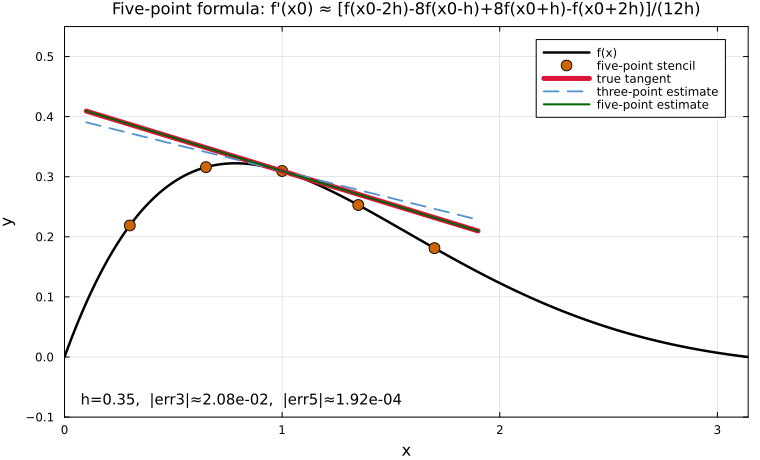
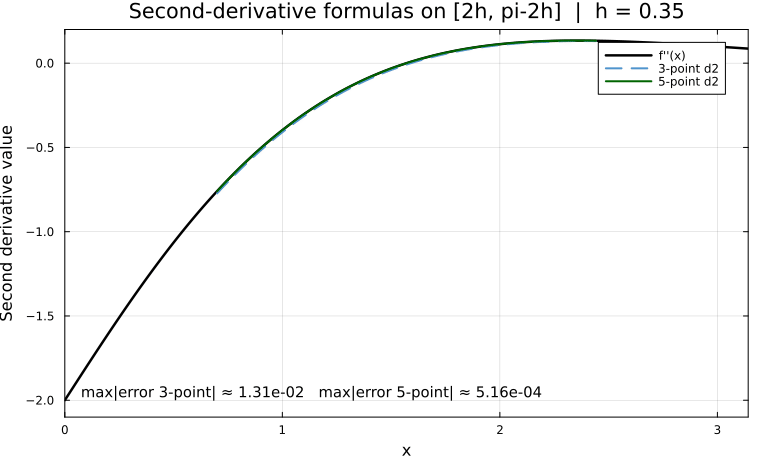

← [Numerical Methods](../)

Source inspiration: [@mathewsSite].

## Description

This topic focuses on how central finite-difference formulas are derived from Taylor expansions and solved in parallel as small linear systems. The legacy module emphasizes deriving first- and second-derivative formulas together rather than treating each formula as an isolated trick.

For symmetric stencils, odd and even Taylor terms cancel in predictable ways, producing compact formulas with clear error orders. The resulting three-point and five-point formulas explain why wider stencils can significantly improve accuracy for smooth functions.

## Animations

Each animation below applies the derived central-difference stencils to the test function $f(x)=e^{-x}\sin(x)$: Case 1 shows the three-point first-derivative formula, and Cases 2 and 3 compare the three-point and five-point stencils for the first and the second derivative. The legacy module derives the formulas symbolically and has no numerical example, so this function was chosen for this page.

### Case 1 - three-point first derivative, $f'(x_0) \approx \dfrac{f(x_0+h)-f(x_0-h)}{2h}$

**Behavior:** The symmetric three-point slope converges to the tangent slope as $h$ decreases, reflecting second-order accuracy.

[Julia source](diffformaa.jl)

### Case 2 - five-point first derivative, $f'(x_0) \approx \dfrac{f(x_0-2h)-8f(x_0-h)+8f(x_0+h)-f(x_0+2h)}{12h}$

**Behavior:** The five-point stencil uses cancellation of lower-order truncation terms, so its error drops faster than the three-point estimate for the same $h$. In the picture the green five-point line already lies on the red true tangent at $h=0.35$, where the two lines differ by about 0.1 pixel at their ends, so the size of the five-point error is read from the $|\text{err5}|$ value printed in each frame.

[Julia source](diffformab.jl)

### Case 3 - second-derivative formulas on $[2h,\pi-2h]$

**Behavior:** The curve profiles compare $f''(x)$ against the three-point and five-point second-derivative stencils on $[2h,\pi-2h]$, where both stencils use only points in $[0,\pi]$; the maximum errors in each frame are taken over this window. From $h=0.35$ to $h=0.005$ both maximum errors shrink, and the five-point stencil stays closer in every frame because it cancels lower-order truncation terms. At $h=0.002$ the five-point maximum error rises slightly, from $5.5\times10^{-11}$ to $5.9\times10^{-11}$, because floating-point rounding now outweighs its truncation error.

[Julia source](diffformac.jl)

## Derivation Notes

From Taylor expansions about $x$,

$$
f(x\pm h)=f(x)\pm hf'(x)+\frac{h^2}{2}f''(x)\pm\frac{h^3}{6}f^{(3)}(x)+\cdots
$$

one obtains

$$
f'(x)=\frac{f(x+h)-f(x-h)}{2h}+O(h^2),
\quad
f''(x)=\frac{f(x+h)-2f(x)+f(x-h)}{h^2}+O(h^2).
$$

Including $x\pm2h$ adds degrees of freedom and yields five-point formulas for $f'$ and $f''$ with $O(h^4)$ truncation error for smooth $f$ (the five-point formulas for $f'''$ and $f^{(4)}$ are only $O(h^2)$).
