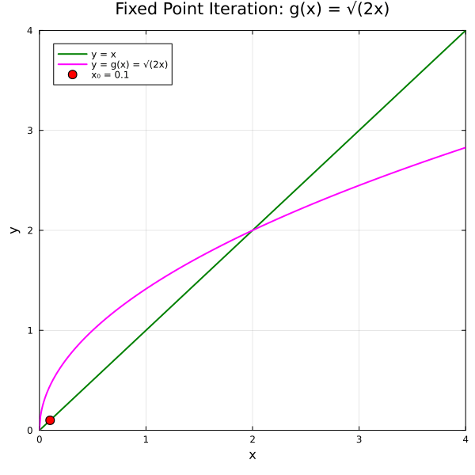
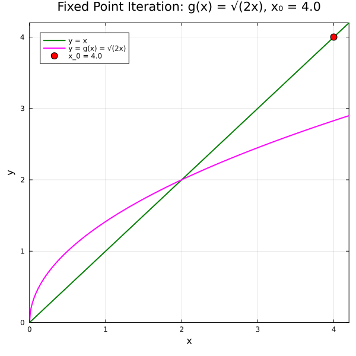

← [Numerical Methods](../)

Source inspiration:  [@mathewsSite].

## Animations

Each animation below shows the **cobweb (staircase) diagram** for fixed point iteration. The diagram
plots two curves — the identity line $y = x$ and the iteration function $y = g(x)$ — then traces
the staircase path: from the current iterate $x_n$ on the diagonal, vertical to the curve to get
$g(x_n) = x_{n+1}$, then horizontal back to the diagonal. For continuously differentiable $g$: if $|g'(x^*)| < 1$, the iteration converges to $x^*$ for every starting value close enough to $x^*$; if $|g'(x^*)| > 1$, iterates near $x^*$ (other than $x^*$ itself) move away from it.

Julia source scripts that generated these animations are linked under each case.

### Case 1 — Convergent staircase, $g(x) = \sqrt{2x}$, $x_0 = 0.1$

**Behavior:** The curve $g(x) = \sqrt{2x}$ meets $y = x$ at $x = 0$ and at $x^* = 2$.
On $(0, 2)$ it is increasing and lies between $y = x$ and $y = 2$, so the iterates climb monotonically to $x^* = 2$, even though $g'(x) > 1$ for $0 < x < \tfrac{1}{2}$, which includes $x_0 = 0.1$.
Near $x^*$ the error is roughly halved at each step, since $g'(2) = \tfrac{1}{2}$.

[Julia source](fixpointaa.jl)

### Case 2 — Convergent staircase, $g(x) = \sqrt{2x}$, $x_0 = 4.0$

**Behavior:** Same function as Case 1 but starting above the fixed point.
The staircase descends monotonically to $x^* = 2$, confirming convergence from both sides.

[Julia source](fixpointbb.jl)

### Case 3 — Oscillating convergent, $g(x) = \tfrac{8}{x+2}$, $x_0 = 4.0$

**Behavior:** The curve $g(x) = \tfrac{8}{x+2}$ is strictly decreasing, with $g'(x) = -\tfrac{8}{(x+2)^2}$, so $g'(2) = -\tfrac{1}{2}$.
Since $|g'(2)| = \tfrac{1}{2} < 1$, iteration converges, but the staircase alternates sides of $x^*$ on each step.

[Julia source](fixpointcc.jl)

### Case 4 — Repelled from $x^* = 2$, converges to $x = 0$, $g(x) = \tfrac{x^2}{4} + \tfrac{x}{2}$, $x_0 = 1.95$

**Behavior:** The curve $g(x) = \tfrac{x^2}{4} + \tfrac{x}{2}$ crosses $y = x$ at $x^* = 2$ (and again at $x = 0$); it lies below the diagonal for $0 < x < 2$.
Since $g'(2) = \tfrac{3}{2} > 1$, the staircase walks away from $x^* = 2$ toward the left and converges monotonically to the other fixed point $x = 0$, where $g'(0) = \tfrac{1}{2}$.

[Julia source](fixpointdd.jl)

### Case 5 — Divergent, $g(x) = \tfrac{x^2}{4} + \tfrac{x}{2}$, $x_0 = 2.03$

**Behavior:** Same function as Case 4 but starting above the fixed point.
The staircase moves monotonically rightward and diverges, showing instability from both sides.
The animation stops at $x_9 \approx 3.753$, the last iterate inside the window; the sequence keeps growing ($x_{12} \approx 29.92$, $x_{14} \approx 1.437 \times 10^4$).

[Julia source](fixpointee.jl)

### Case 6 — Oscillating, does not converge, $g(x) = -\tfrac{x^2}{4} - \tfrac{x}{2} + 4$, $x_0 = 1.97$

**Behavior:** The curve $g(x) = -\tfrac{x^2}{4} - \tfrac{x}{2} + 4$ is steeply decreasing at $x^* = 2$.
Since $g'(2) = -\tfrac{3}{2}$ and $|g'(2)| = \tfrac{3}{2} > 1$, the iteration does not converge to $x^*$: the staircase moves away from $x^* = 2$, alternating sides at every step, and settles onto a stable 4-cycle (≈ 4.25, −2.64, 3.58, −0.99).

[Julia source](fixpointff.jl)

