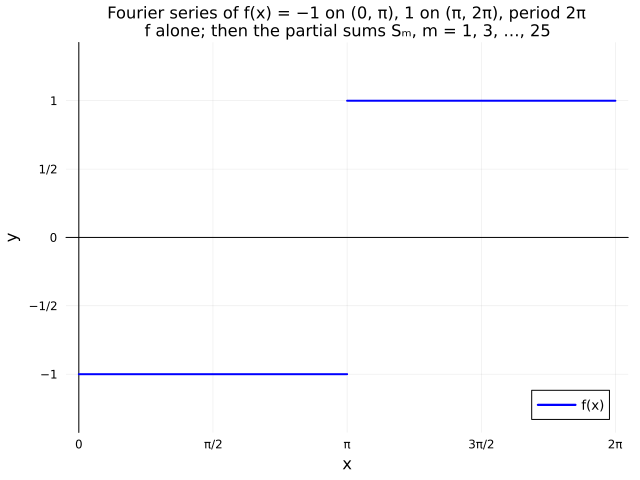
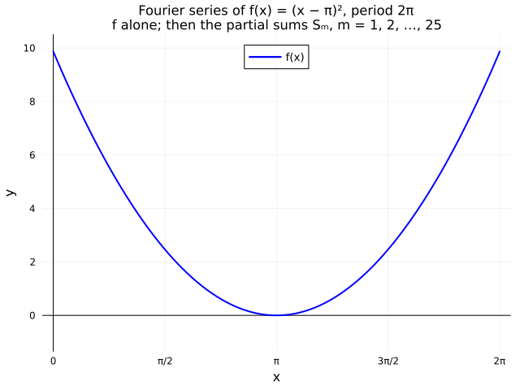
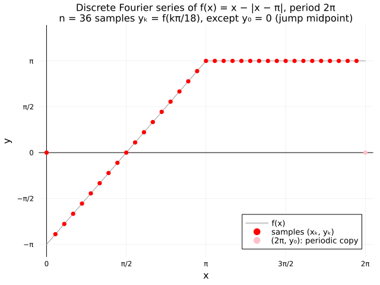

← [Numerical Methods](../)

Source inspiration: [@mathewsSite].

## Description

A function $f$ with period $2L$ that is piecewise continuous can be expanded in a **Fourier series**, a sum of cosines and sines whose frequencies are whole multiples of $\pi/L$:

$$
S(x) = \frac{a_0}{2} + \sum_{j=1}^{\infty}\left(a_j\cos\!\left(\frac{j\pi x}{L}\right) + b_j\sin\!\left(\frac{j\pi x}{L}\right)\right),
\qquad
a_j = \frac{1}{L}\int_0^{2L} f(x)\cos\!\left(\frac{j\pi x}{L}\right)dx,\quad
b_j = \frac{1}{L}\int_0^{2L} f(x)\sin\!\left(\frac{j\pi x}{L}\right)dx .
$$

Stopping the sum at $j=m$ gives the Fourier polynomial $S_m(x)$ of degree $m$. Where $f$ is continuous and has a piecewise continuous derivative, $S_m(x)\to f(x)$ as $m$ grows. At a jump, $S_m$ converges to the midpoint of the jump, and next to the jump the partial sums overshoot by about $9\%$ of the jump however large $m$ is (the Gibbs phenomenon).

When only $n$ equally spaced samples $y_k = f(x_k)$, $x_k = 2Lk/n$ for $k = 0,1,\ldots,n-1$, are known, the integrals are replaced by sums, giving the **discrete Fourier series**, or trigonometric polynomial, of degree $m$ (with $2m+1\le n$):

$$
P_m(x) = \frac{a_0}{2} + \sum_{j=1}^{m}\left(a_j\cos\!\left(\frac{j\pi x}{L}\right) + b_j\sin\!\left(\frac{j\pi x}{L}\right)\right),
\qquad
a_j = \frac{2}{n}\sum_{k=0}^{n-1} y_k\cos\!\left(\frac{j\pi x_k}{L}\right),\quad
b_j = \frac{2}{n}\sum_{k=0}^{n-1} y_k\sin\!\left(\frac{j\pi x_k}{L}\right).
$$

Equivalently, $a_j = \tfrac{2}{n}\operatorname{Re} Y_j$ and $b_j = -\tfrac{2}{n}\operatorname{Im} Y_j$, where $Y_j$ is the discrete Fourier transform of the data (equation (10) below), which the fast Fourier transform (FFT) computes. $P_m$ is the least-squares trigonometric fit to the samples, and it passes through every sample when $n = 2m+1$. The examples use $L=\pi$, with $f(x) = \lvert x-\pi\rvert$ for Mathews' five examples and the functions of his animations for the rest.

## Animations

Each animation draws one period, $0 \le x \le 2\pi$, of a function with period $2\pi$ and raises the degree $m$ by one per frame, or by two in Cases 1, 3 and 6, whose terms of even degree $j \ge 2$ are zero. The first frame shows the function alone (Cases 1–5) or the samples with the graph of $f$ (Cases 6–8), and the last frame is held. Cases 1–5 show the Fourier polynomials $S_m$ of (3), with the coefficients of Example 2, as Mathews drew them: $f$ in blue and $S_m$ in magenta. The second line of each title gives one number for the frame. For a function whose periodic extension is continuous (Cases 1 and 4) it is the largest error $\max_x \lvert f(x) - S_m(x)\rvert$. For one whose periodic extension jumps (Cases 2, 3 and 5) it is the largest value $\max_x S_m(x)$, to compare with the least upper bound of $f$. As $m$ grows, the excess $\max_x S_m(x) - \sup f$ tends to the Gibbs overshoot. In Case 2, whose $f$ rises right up to the jump, it does so slowly ($0.4407$ for $m = 25$), so its Behavior paragraph measures the overshoot from the line instead. Cases 6–8 show the trigonometric polynomials $P_m$ of (8) for the $n = 36$ samples of Example 7, as in Mathews' animations: the samples are red dots, $P_m$ is magenta, and a pale pink dot marks the periodic copy $(2\pi, y_0)$ of the first sample, which is not itself a sample. The thin grey graph of $f$ is an addition, so that the samples at the jumps can be compared with the one-sided limits. The scripts evaluate the sums (6)–(7) directly rather than calling an FFT routine; both give the same coefficients up to rounding.

Mathews' module links ten animations, five of Fourier series and five of discrete Fourier series ("FFT"). The Fourier-series animations are for the functions $\lvert x-\pi\rvert$, $x-\pi$, a unit step, $(x-\pi)^2$ and $x-\lvert x-\pi\rvert$. Four GIFs survive: the Fourier series of $x-\lvert x-\pi\rvert$ and the discrete series of the step, $(x-\pi)^2$ and $x-\lvert x-\pi\rvert$. Cases 5–8 rebuild them with the degrees read from their frames and with his sample points, including the midpoint values at the jumps. Cases 1–4 (marked "rebuilt") stand in for his lost Fourier-series animations of the first four functions. Their functions are listed on his index page, but their frames are lost, so they take the picture and the range $m \le 25$ from the surviving animation (Case 5) and the values $\mp 1$ of the step from Case 6; Cases 1 and 3 show odd $m$ only, because the even-$j$ coefficients of those functions are zero and $S_m = S_{m-1}$ for even $m$. His first two discrete-series animations are not rebuilt. Their GIFs and formula images are lost, though the index page's layout indicates they used $\lvert x-\pi\rvert$ and $x-\pi$: its list of five animations matches the Fourier-series index entry for entry, with the same bullet colours and link pattern and formula images of the same declared sizes in the same order, and its one surviving formula image, the fifth, is byte-identical to the Fourier-series one for $x-\lvert x-\pi\rvert$. Mathews' five worked examples (Examples 1 and 3–6 here) have static graphs and are not animated, although $S_5$ of Example 1 appears as a frame of Case 1. Every case has a Mathews original, surviving or lost; none is new.

Julia source scripts that generated these animations are linked under each case.

### Case 1 — $f(x) = \lvert x-\pi\rvert$, $S_m$ for $m = 1, 3, \ldots, 25$ (rebuilt)

**Behavior:** The periodic extension of $f$ is continuous, so $S_m \to f$ uniformly. Every $a_j$ with even $j \ge 2$ is zero, so the frames show odd $m$. The error is largest at the corners $x = 0$, $\pi$ and $2\pi$, where all the terms of $f - S_m$ have the same sign, and there it equals the tail sum $\tfrac{4}{\pi}\sum_{j>m,\ j\ \text{odd}} j^{-2}$. It falls at every frame, from $0.2976$ for $m = 1$ to $0.1052$ for $m = 5$ (Example 1) and $0.02447$ for $m = 25$.

[Julia source](fourierseriesaa.jl)

### Case 2 — $f(x) = x-\pi$, $S_m$ for $m = 1, 2, \ldots, 25$ (rebuilt)

**Behavior:** The series has only sine terms, $b_j = -2/j$, so $S_m(0) = S_m(\pi) = S_m(2\pi) = 0$ for every $m$. At $x = 0$ and $2\pi$ this is the midpoint of the jump of the periodic extension from $\pi$ down to $-\pi$, and at $x = \pi$ it is $f(\pi)$. Beside the jump at $2\pi$, $S_m$ peaks at $x = 2\pi - \pi/(m+1)$; the peak value rises at every frame, from $2$ for $m = 1$ to $3.582$ for $m = 25$. Measured from the line $f$ below it, the overshoot at the peak is $0.5477$ for $m = 5$ and $0.5615$ for $m = 25$, close to the Gibbs value $0.0895 \times 2\pi = 0.5623$: it moves toward the jump but does not shrink. Since $S_m(2\pi - x) = -S_m(x)$, the same undershoot appears beside $x = 0$.

[Julia source](fourierseriesbb.jl)

### Case 3 — Mathews' unit step, $f = -1$ on $(0, \pi)$ and $1$ on $(\pi, 2\pi)$, $S_m$ for $m = 1, 3, \ldots, 25$ (rebuilt)

**Behavior:** Only the sine terms with odd $j$ are nonzero, so the frames show odd $m$, and $S_m(0) = S_m(\pi) = S_m(2\pi) = 0$, the midpoints of the jumps, for every $m$. The graph of $f$ is broken at $x = \pi$ and has no value drawn there. The largest value of $S_m$ falls at every frame, from $4/\pi \approx 1.273$ for $m = 1$ to $1.188$ for $m = 5$ and $1.179$ for $m = 25$, staying above the Gibbs value $1 + 0.0895 \times 2 = 1.179$ (more precisely $1.17898$, against $1.17947$ for $m = 25$). The peaks sit a distance $\pi/(m+1)$ from the jumps, so they move toward them, but the overshoot of about $9\%$ of the jump remains.

[Julia source](fourierseriescc.jl)

### Case 4 — $f(x) = (x-\pi)^2$, $S_m$ for $m = 1, 2, \ldots, 25$ (rebuilt)

**Behavior:** The periodic extension is continuous, with corners at $x = 0$ and $2\pi$, so $S_m \to f$ uniformly. Every coefficient $a_j = 4/j^2$ is positive, so all the terms of $f - S_m = \sum_{j>m} 4\cos(jx)/j^2$ equal their largest value at $x = 0$ and $2\pi$, where the error is the tail sum $4\sum_{j>m} j^{-2}$. It falls at every frame, from $2.580$ for $m = 1$ to $0.7253$ for $m = 5$ and $0.1568$ for $m = 25$.

[Julia source](fourierseriesdd.jl)

### Case 5 — $f(x) = x-\lvert x-\pi\rvert$, $S_m$ for $m = 1, 2, \ldots, 25$ (Mathews' animation)

**Behavior:** The frames follow Mathews' sequence $S_1, S_2, \ldots, S_{25}$; Example 2 works this function in full. Inside the period $f$ is continuous, with a corner at $x = \pi$; its periodic extension jumps from $\pi$ down to $-\pi$ at $x = 0$ and $2\pi$. Unlike Case 2, the cosine terms do not vanish there, so $S_m(0) = \tfrac{\pi}{2} - \tfrac{4}{\pi}\sum_{j\ \text{odd} \le m} j^{-2}$ is not $0$ but tends to it, from $0.2976$ for $m = 1$ to $0.02447$ for $m = 25$. The largest value of $S_m$ is $3.942$ for $m = 1$; from $m = 2$ on it stays between $3.673$ and $3.734$, without a monotone trend, around the Gibbs value $\pi + 0.0895 \times 2\pi = 3.704$, and for $m = 25$ it is $3.702$, beside the jump at $x \approx 6.160$.

[Julia source](fourierseriesee.jl)

### Case 6 — Discrete series of the unit step, $n = 36$, $P_m$ for $m = 1, 3, \ldots, 17$ (Mathews' animation)

**Behavior:** The frames follow Mathews' sequence of degrees $1, 3, \ldots, 17$. The samples at the jumps, $x_0 = 0$ and $x_{18} = \pi$, are the midpoints $y_0 = y_{18} = 0$. The data satisfy $y_{36-k} = -y_k$ and $y_{k+18} = -y_k$, so every $a_j$ and every $b_j$ with even $j$ is zero: $P_m$ is a sum of odd sines, with $P_m(0) = P_m(\pi) = 0$ for every $m$. Its largest value falls at every frame, from $1.270$ for $m = 1$ to $1.065$ for $m = 17$. Since $2m + 1 = 35$ and the alternating sum in (9) is zero, $P_{17}$ passes through all 36 samples, and its peak, $1.065$, is well below the $1.180$ of the Fourier polynomial $S_{17}$: interpolating midpoint samples damps the overshoot (Example 7).

[Julia source](fourierfftcc.jl)

### Case 7 — Discrete series of $f(x) = (x-\pi)^2$, $n = 36$, $P_m$ for $m = 1, 2, \ldots, 17$ (Mathews' animation)

**Behavior:** The frames follow Mathews' sequence of degrees $1, 2, \ldots, 17$. $f$ is continuous, so the samples are $y_k = f(x_k)$, and $P_m$ is the least-squares fit of degree $m$. Even $P_{17}$ does not interpolate: $n = 36 = 2 \cdot 17 + 2$, and the alternating sum in (9) gives $a_{18} = 0.030462$, so $P_{17}$ misses every sample by $0.015231$, alternately above and below. The largest error $\max_x \lvert f(x) - P_m(x)\rvert$ falls from $2.564$ for $m = 1$ to $0.1856$ for $m = 12$, then grows slightly, to $0.2042$ for $m = 17$, at $x \approx 0.074$ beside the corner of the periodic extension at $x = 0$. That is still below the $0.2285$ of the Fourier polynomial $S_{17}$ (Example 7).

[Julia source](fourierfftdd.jl)

### Case 8 — Discrete series of $f(x) = x-\lvert x-\pi\rvert$, $n = 36$, $P_m$ for $m = 1, 2, \ldots, 17$ (Mathews' animation)

**Behavior:** The frames follow Mathews' sequence of degrees $1, 2, \ldots, 17$. The sample at the jump $x_0 = 0$ is the midpoint $y_0 = 0$ of $f(0^+) = -\pi$ and $f(2\pi^-) = \pi$. The alternating sum in (9) is zero, so $P_{17}$ passes through all 36 samples, and in particular $P_{17}(0) = 0$. The largest value of $P_m$ is $3.939$ for $m = 1$; it is not monotone over the first frames, but from $m = 5$ on it falls at every frame, to $3.365$ for $m = 17$, below the $3.702$ of the Fourier polynomial $S_{17}$ in Case 5. The lowest value of $P_{17}$ is $-2.880$, at $x \approx 0.215$, so the samples keep $P_{17}$ above $-\pi$ beside the jump.

[Julia source](fourierfftee.jl)

## Fourier Series

### Definitions

::: {.callout-note appearance="simple"}
## Definition — Piecewise continuous
A function $f$ is piecewise continuous on $[a,b]$ if there are points $a = x_0 < x_1 < \cdots < x_n = b$ such that $f$ is continuous on each open interval $x_{k-1} < x < x_k$ and has one-sided limits at each $x_k$, for $k = 0, 1, \ldots, n$.
:::

::: {.callout-note appearance="simple"}
## Definition — Fourier series
If $f$ has period $2L$ and is piecewise continuous on $[0,2L]$, its Fourier series is

$$
S(x) = \frac{a_0}{2} + \sum_{j=1}^{\infty}\left(a_j\cos\!\left(\frac{j\pi x}{L}\right) + b_j\sin\!\left(\frac{j\pi x}{L}\right)\right),
\tag{1}
$$

with coefficients given by **Euler's formulas**

$$
a_j = \frac{1}{L}\int_0^{2L} f(x)\cos\!\left(\frac{j\pi x}{L}\right)dx \quad (j = 0,1,\ldots),
\qquad
b_j = \frac{1}{L}\int_0^{2L} f(x)\sin\!\left(\frac{j\pi x}{L}\right)dx \quad (j = 1,2,\ldots).
\tag{2}
$$
:::

The factor $\tfrac12$ on $a_0$ lets one formula cover every $a_j$: $a_0/2$ is the mean value of $f$ over a period.

::: {.callout-note appearance="simple"}
## Definition — Fourier polynomial
The Fourier polynomial of degree $m$ is the partial sum of (1),

$$
S_m(x) = \frac{a_0}{2} + \sum_{j=1}^{m}\left(a_j\cos\!\left(\frac{j\pi x}{L}\right) + b_j\sin\!\left(\frac{j\pi x}{L}\right)\right),
\tag{3}
$$

with the coefficients (2) for $j = 0, 1, \ldots, m$.
:::

### Convergence

::: {.callout-tip appearance="simple"}
## Theorem — Fourier expansion
Let $S(x)$ be the Fourier series of $f$. If $f$ and $f'$ are piecewise continuous on $[0,2L]$, then $S(x)$ converges for every $x$. It equals $f(x)$ at every $x$ where $f$ is continuous, and at a point $a$ where $f$ jumps,

$$
S(a) = \frac{f(a^-) + f(a^+)}{2},
\tag{4}
$$

the midpoint of the left- and right-hand limits. At $x = 0$ and $x = 2L$ the limits are those of the periodic extension, so $S(0) = \tfrac12\left(f(2L^-) + f(0^+)\right)$.
:::

Three general facts describe *how* the partial sums approach $f$. They are standard theorems; the examples below check them for specific functions.

- **Uniform convergence.** If the periodic extension of $f$ is continuous and $f'$ is piecewise continuous, then $\max_x \lvert f(x) - S_m(x)\rvert \to 0$.
- **Gibbs phenomenon.** If $f$ jumps by $J$ at $a$, the largest overshoot of $S_m$ beside the jump does not tend to zero as $m$ grows; it tends to $\left(\tfrac{1}{\pi}\operatorname{Si}(\pi) - \tfrac12\right)J \approx 0.0895\,J$, where $\operatorname{Si}(\pi) = \int_0^\pi \tfrac{\sin t}{t}\,dt \approx 1.8519$. The overshoot moves closer to the jump as $m$ grows, so convergence is not uniform near a jump.
- **Coefficient decay.** Coefficients of a function whose periodic extension jumps decrease like $1/j$; those of a continuous function with a jump only in $f'$ decrease like $1/j^2$. The functions in Example 2 show both rates.

::: {.callout-warning appearance="simple"}
## The value of $f$ at a jump
The integrals (2) do not depend on the value of $f$ at isolated points, but the series does not converge to an arbitrary value there: by (4) it converges to the midpoint. When data are sampled at a jump, using the midpoint value keeps the samples consistent with the series. Mathews' discrete-series animations do this (Example 7).
:::

### Example 1 — $f(x) = \lvert x - \pi\rvert$, degree 5 (Mathews' Example 1)

Let $f$ have period $2\pi$ (so $L = \pi$) with

$$
f(x) = \lvert x-\pi\rvert, \qquad 0 \le x \le 2\pi .
$$

Find the Fourier polynomial of degree $m = 5$.

**Step 1** (constant term): the graph over $[0,2\pi]$ is a "V" enclosing two triangles of area $\pi^2/2$, so

$$
a_0 = \frac1\pi\int_0^{2\pi}\lvert x-\pi\rvert\,dx = \frac{1}{\pi}\cdot\pi^2 = \pi .
$$

**Step 2** (sine terms): replacing $x$ by $2\pi - x$ leaves $f$ unchanged but changes the sign of $\sin(jx)$, so the two halves of each integral cancel:

$$
b_j = 0, \qquad j = 1, 2, \ldots
$$

**Step 3** (cosine terms): $f$ and $\cos(jx)$ are both symmetric about $x=\pi$, so integrate over $[0,\pi]$, double, and integrate by parts:

$$
a_j = \frac{2}{\pi}\int_0^{\pi}(\pi-x)\cos(jx)\,dx
= \frac{2}{\pi}\left(\Big[\frac{(\pi-x)\sin(jx)}{j}\Big]_0^{\pi} + \frac1j\int_0^\pi \sin(jx)\,dx\right)
= \frac{2\left(1-(-1)^j\right)}{\pi j^2}.
$$

So $a_j = \dfrac{4}{\pi j^2}$ for odd $j$ and $a_j = 0$ for even $j \ge 2$.

**Step 4** (assemble):

$$
\boxed{S_5(x) = \frac{\pi}{2} + \frac{4}{\pi}\left(\cos x + \frac{\cos 3x}{9} + \frac{\cos 5x}{25}\right)}
\approx 1.570796 + 1.273240\cos x + 0.141471\cos 3x + 0.050930\cos 5x .
$$

**Verification.** The coefficients were also computed by adaptive quadrature of (2); the two agree to better than $10^{-15}$ for $j \le 6$. The partial sum against $f$:

| $x$ | $f(x)$ | $S_5(x)$ | $f(x) - S_5(x)$ |
|-----|--------|----------|-----------------|
| $0$ | $3.141593$ | $3.036437$ | $0.105156$ |
| $\pi/3$ | $2.094395$ | $2.091410$ | $0.002985$ |
| $\pi/2$ | $1.570796$ | $1.570796$ | $0.000000$ |
| $\pi$ | $0$ | $0.105156$ | $-0.105156$ |

The error is largest at the corners $x = 0$ and $x = \pi$. Because every term of $f - S_m = \sum_{j>m,\ j\text{ odd}} \tfrac{4}{\pi j^2}\cos(jx)$ has the same sign at $x = 0$, the maximum error is exactly the tail sum $\tfrac{4}{\pi}\sum_{j>m,\ j \text{ odd}} j^{-2}$. This $f$ is continuous and periodic, so the convergence is uniform:

| $m$ | $5$ | $25$ | $99$ |
|-----|-----|------|------|
| $\max_x \lvert f - S_m\rvert$ | $0.105156$ | $0.024473$ | $0.006366$ |
| $2/(\pi m)$ | $0.127324$ | $0.025465$ | $0.006431$ |

For large $m$ the maximum error behaves like $2/(\pi m)$.

### Example 2 — The functions of Mathews' Fourier-series animations

Mathews' Fourier-series animations use five functions of period $2\pi$, each given on $0 < x < 2\pi$. The first is Example 1; the others have these coefficients (computed with sympy and checked by quadrature for $j \le 6$):

| $f(x)$ on $(0, 2\pi)$ | $a_0$ | $a_j$, $j\ge1$ | $b_j$ |
|-----------------------|-------|----------------|-------|
| $\lvert x-\pi\rvert$ | $\pi$ | $\dfrac{2(1-(-1)^j)}{\pi j^2}$ | $0$ |
| $x - \pi$ | $0$ | $0$ | $-\dfrac{2}{j}$ |
| $-1$ on $(0,\pi)$, $+1$ on $(\pi,2\pi)$ (Mathews' "unit step") | $0$ | $0$ | $-\dfrac{2(1-(-1)^j)}{\pi j}$ |
| $(x-\pi)^2$ | $\dfrac{2\pi^2}{3}$ | $\dfrac{4}{j^2}$ | $0$ |
| $x - \lvert x-\pi\rvert$ | $\pi$ | $-\dfrac{2(1-(-1)^j)}{\pi j^2}$ | $-\dfrac{2}{j}$ |

The decay rates match the general rule. The periodic extensions of $x-\pi$, the step and $x-\lvert x-\pi\rvert$ jump, and their $b_j$ fall like $1/j$. The extensions of $\lvert x-\pi\rvert$ and $(x-\pi)^2$ are continuous, and their $a_j$ fall like $1/j^2$.

**The function $x - \lvert x-\pi\rvert$** (the surviving animation) equals $2x - \pi$ on $[0,\pi]$ and $\pi$ on $[\pi, 2\pi]$. Its coefficients follow by linearity from the identity

$$
x - \lvert x-\pi\rvert = (x-\pi) - \lvert x-\pi\rvert + \pi ,
$$

which adds the rows for $x-\pi$ and $-\lvert x-\pi\rvert$ and adds $2\pi$ to $a_0$ (the constant $\pi$ has $a_0 = 2\pi$):

$$
a_0 = 0 - \pi + 2\pi = \pi, \qquad a_j = -\frac{2(1-(-1)^j)}{\pi j^2}, \qquad b_j = -\frac{2}{j},
$$

$$
S_m(x) = \frac{\pi}{2} - \frac{4}{\pi}\sum_{\substack{j=1\\ j\ \text{odd}}}^{m}\frac{\cos jx}{j^2} - 2\sum_{j=1}^{m}\frac{\sin jx}{j}.
$$

The periodic extension jumps at $x = 0$ (and $2\pi$) from $f(2\pi^-) = \pi$ down to $f(0^+) = -\pi$, a jump of $2\pi$; at $x = \pi$ it is continuous with a corner.

**Verification against the convergence theorem:**

- *At the jump.* All sines vanish at $x=0$, so $S_m(0) = \tfrac{\pi}{2} - \tfrac{4}{\pi}\sum_{j\ \text{odd} \le m} j^{-2}$. This tends to $\tfrac{\pi}{2} - \tfrac{4}{\pi}\cdot\tfrac{\pi^2}{8} = 0$, the midpoint of $-\pi$ and $\pi$, as (4) predicts. Numerically $S_5(0) = 0.105156$ and $S_{25}(0) = 0.024473$.
- *At the corner.* $S_m(\pi) = \tfrac{\pi}{2} + \tfrac{4}{\pi}\sum_{j\ \text{odd}\le m} j^{-2} \to \pi = f(\pi)$; $S_{25}(\pi) = 3.117119$.
- *Gibbs overshoot.* The predicted limit is $0.0895 \times 2\pi \approx 0.5623$. For $m = 25$ the maximum of $S_{25}$ just left of $2\pi$ is $3.70189$ at $x \approx 6.160$, which is $0.5603$ above $\pi$. Just right of $0$, $S_{25}$ falls $0.5651$ below $f$ at $x \approx 0.123$. For $m = 400$ the two figures are $0.5621$ and $0.5625$, so the overshoot does not die out.

For the step function the same theorem predicts a peak of $1 + 2\left(\tfrac{1}{\pi}\operatorname{Si}(\pi) - \tfrac12\right) \approx 1.17898$. The partial sums peak at $1.18001$ for $m = 17$ and $1.17901$ for $m = 101$.

## Discrete Fourier Series from Equally Spaced Data

### Replacing the integrals by sums

Suppose $f$ is known only at $n$ equally spaced points of one period,

$$
x_k = k\,\frac{2L}{n}, \qquad y_k = f(x_k), \qquad k = 0, 1, \ldots, n-1,
\tag{5}
$$

with $\Delta x = 2L/n$. Applying the trapezoidal rule to Euler's formulas (2) on these $n$ subintervals gives the discrete coefficients.

::: {.callout-important appearance="simple"}
## Discrete Fourier coefficients
$$
a_j = \frac{1}{L}\sum_{k=0}^{n-1} y_k\cos\!\left(\frac{j\pi x_k}{L}\right)\Delta x = \frac{2}{n}\sum_{k=0}^{n-1} y_k\cos\!\left(\frac{2\pi jk}{n}\right), \quad j = 0, 1, \ldots, m,
\tag{6}
$$

$$
b_j = \frac{2}{n}\sum_{k=0}^{n-1} y_k\sin\!\left(\frac{2\pi jk}{n}\right), \quad j = 1, 2, \ldots, m,
\tag{7}
$$

and the trigonometric polynomial is

$$
P_m(x) = \frac{a_0}{2} + \sum_{j=1}^{m}\left(a_j\cos\!\left(\frac{j\pi x}{L}\right) + b_j\sin\!\left(\frac{j\pi x}{L}\right)\right).
\tag{8}
$$

The construction needs $2m + 1 \le n$: there are $2m+1$ coefficients and only $n$ data.
:::

**Why the weights are all 1.** The trapezoidal rule gives weight $\tfrac12$ to the two end ordinates $f(x_0)$ and $f(x_n)$. The data are periodic, $f(x_n) = f(x_0)$, so the two halves combine into one full weight on $y_0$. The sum therefore runs over exactly the $n$ ordinates $y_0, \ldots, y_{n-1}$, and the right endpoint $x_n = 2L$ must not be added again (Example 4 shows what goes wrong).

### What the discrete coefficients are

::: {.callout-tip appearance="simple"}
## Theorem — Discrete orthogonality and least squares
For $0 \le j, l \le m$ with $2m < n$ ($1 \le j, l \le m$ in the sine relation),

$$
\sum_{k=0}^{n-1}\cos(jx_k)\cos(lx_k) = \begin{cases} n, & j = l = 0,\\ n/2, & j = l \ge 1,\\ 0, & j \ne l,\end{cases}
\qquad
\sum_{k=0}^{n-1}\sin(jx_k)\sin(lx_k) = \tfrac{n}{2}\,\delta_{jl},
\qquad
\sum_{k=0}^{n-1}\cos(jx_k)\sin(lx_k) = 0,
$$

(here with $L = \pi$, so $x_k = 2\pi k/n$). Consequently the normal equations of the least-squares fit of a degree-$m$ trigonometric polynomial to the $n$ data are diagonal, and their solution is exactly (6)–(7): **$P_m$ is the least-squares trigonometric polynomial of degree $m$.** If $n = 2m+1$ it interpolates the data. If $n = 2m+2$, the residual at the nodes is

$$
y_k - P_m(x_k) = \frac{a_{n/2}}{2}(-1)^k, \qquad a_{n/2} = \frac{2}{n}\sum_{k=0}^{n-1}(-1)^k y_k,
\tag{9}
$$

so $P_m$ interpolates exactly when the alternating sum of the data is zero.
:::

::: {.callout-tip appearance="simple"}
## Theorem — Aliasing
If the Fourier series of $f$ converges absolutely, or if $f$ is piecewise smooth and its samples at jumps are the midpoint values (the series in $l$ must then be summed pair by pair, as written), the discrete coefficients from $n$ samples are sums of the true coefficients folded onto frequencies $0, \ldots, n/2$:

$$
a_j^{\text{disc}} = a_j + \sum_{l=1}^{\infty}\left(a_{ln+j} + a_{ln-j}\right), \qquad
b_j^{\text{disc}} = b_j + \sum_{l=1}^{\infty}\left(b_{ln+j} - b_{ln-j}\right).
$$

The discrete coefficients therefore approximate the Fourier coefficients well only when the coefficients beyond frequency $n/2$ are small.
:::

### Example 3 — 12 samples by numerical integration (Mathews' Example 2)

Use $f(x) = \lvert x - \pi\rvert$ from Example 1. Find the trigonometric polynomial of degree $m = 5$ from the $n = 12$ equally spaced points of $[0, 2\pi]$, computing the coefficients by numerical integration of (2).

**Step 1** (nodes and data): $L = \pi$, $\Delta x = 2\pi/12 = \pi/6$ and $x_k = k\pi/6$, so $\tfrac1L\Delta x = \tfrac{2}{12}$:

| $k$ | $0$ | $1$ | $2$ | $3$ | $4$ | $5$ | $6$ | $7$ | $8$ | $9$ | $10$ | $11$ |
|-----|-----|-----|-----|-----|-----|-----|-----|-----|-----|-----|------|------|
| $x_k$ | $0$ | $\tfrac{\pi}{6}$ | $\tfrac{\pi}{3}$ | $\tfrac{\pi}{2}$ | $\tfrac{2\pi}{3}$ | $\tfrac{5\pi}{6}$ | $\pi$ | $\tfrac{7\pi}{6}$ | $\tfrac{4\pi}{3}$ | $\tfrac{3\pi}{2}$ | $\tfrac{5\pi}{3}$ | $\tfrac{11\pi}{6}$ |
| $y_k$ | $\pi$ | $\tfrac{5\pi}{6}$ | $\tfrac{2\pi}{3}$ | $\tfrac{\pi}{2}$ | $\tfrac{\pi}{3}$ | $\tfrac{\pi}{6}$ | $0$ | $\tfrac{\pi}{6}$ | $\tfrac{\pi}{3}$ | $\tfrac{\pi}{2}$ | $\tfrac{2\pi}{3}$ | $\tfrac{5\pi}{6}$ |

**Step 2** (constant term): $\sum y_k = 6\pi$, so $a_0 = \tfrac{2}{12}\cdot 6\pi = \pi$.

**Step 3** (sine terms): the data satisfy $y_{12-k} = y_k$ while $\sin(jx_{12-k}) = -\sin(jx_k)$, so the terms cancel in pairs and $b_j = 0$ for every $j$.

**Step 4** (cosine terms): with $\cos(3x_k) = 1, 0, -1, 0, 1, 0, -1, 0, 1, 0, -1, 0$,

$$
a_3 = \frac{2}{12}\left(\pi - \frac{2\pi}{3} + \frac{\pi}{3} - 0 + \frac{\pi}{3} - \frac{2\pi}{3}\right) = \frac{2}{12}\cdot\frac{\pi}{3} = \frac{\pi}{18} \approx 0.174533 .
$$

The same computation with $\cos(x_k) = 1, \tfrac{\sqrt3}{2}, \tfrac12, 0, -\tfrac12, -\tfrac{\sqrt3}{2}, -1, \ldots$ and with $\cos(5x_k)$ gives

$$
\sum_k y_k\cos x_k = \frac{2\pi(2+\sqrt3)}{3}, \qquad
a_1 = \frac{\pi(2+\sqrt3)}{9} \approx 1.302731, \qquad
a_5 = \frac{\pi(2-\sqrt3)}{9} \approx 0.093532,
$$

and $a_2 = a_4 = 0$.

**Step 5** (assemble):

$$
\boxed{P_5(x) = \frac{\pi}{2} + \frac{\pi(2+\sqrt3)}{9}\cos x + \frac{\pi}{18}\cos 3x + \frac{\pi(2-\sqrt3)}{9}\cos 5x}
\approx 1.570796 + 1.302731\cos x + 0.174533\cos 3x + 0.093532\cos 5x .
$$

Mathews' printed values ($1.5708$, $1.30273$, $0.174533$, $0.0935319$) agree.

**Verification.** Here $n = 12 = 2m + 2$, and the alternating sum in (9) is $\pi - \tfrac{5\pi}{6} + \tfrac{2\pi}{3} - \cdots - \tfrac{5\pi}{6} = 0$. So $P_5$ passes through all twelve data points:

| $k$ | $0$ | $1$ | $2$ | $3$ | $4$ | $5$ | $6$ |
|-----|-----|-----|-----|-----|-----|-----|-----|
| $P_5(x_k)$ | $3.141593$ | $2.617994$ | $2.094395$ | $1.570796$ | $1.047198$ | $0.523599$ | $0.000000$ |
| $y_k$ | $\pi \checkmark$ | $\tfrac{5\pi}{6}\checkmark$ | $\tfrac{2\pi}{3}\checkmark$ | $\tfrac{\pi}{2}\checkmark$ | $\tfrac{\pi}{3}\checkmark$ | $\tfrac{\pi}{6}\checkmark$ | $0\checkmark$ |

($k = 7, \ldots, 11$ repeat $k = 5, \ldots, 1$ by symmetry; sympy gives $P_5(x_k) - y_k = 0$ exactly for all twelve.)

**Comparison with the Fourier coefficients.** The discrete coefficients approximate those of Example 1, and the gap widens with $j$:

| $j$ | Fourier $a_j$ (Example 1) | discrete $a_j$ | difference |
|-----|---------------------------|----------------|------------|
| $1$ | $1.273240$ | $1.302731$ | $0.029492$ |
| $3$ | $0.141471$ | $0.174533$ | $0.033062$ |
| $5$ | $0.050930$ | $0.093532$ | $0.042602$ |

The aliasing theorem accounts for the differences: summing $a_{12l+j} + a_{12l-j}$ over $l$ reproduces each discrete value to the accuracy of the truncated sum (within $10^{-6}$). The two polynomials differ by at most $0.105156$, at the nodes $x = 0$ and $x = \pi$, where $P_5$ matches the corners of $f$ and $S_5$ misses them. Between the nodes $P_5$ also misses: $\max_x \lvert f - P_5\rvert = 0.1009$, near $x \approx 3.356$.

### Example 4 — The same data given as points (Mathews' Example 3)

Now the twelve points $(x_k, y_k)$ of the table in Example 3 are given as data, $(0,\pi), (\tfrac{\pi}{6}, \tfrac{5\pi}{6}), \ldots, (\tfrac{11\pi}{6}, \tfrac{5\pi}{6})$, extended periodically by $(x_{12}, y_{12}) = (2\pi, \pi)$. Find the degree-5 trigonometric polynomial with the sums (6)–(7).

What changes from Example 3 is only the bookkeeping: the weight $\tfrac{1}{L}\Delta x$ is written $\tfrac{2}{n} = \tfrac{1}{6}$, and the ordinates come from a table instead of a formula. The sums are identical, so the result is the same $P_5$ as in Example 3.

**The endpoint pitfall.** Suppose the sums are taken over $k = 0, \ldots, 12$, so the point $(2\pi, \pi)$ is included as well as $(0, \pi)$. Each sum gains the term $y_{12}\cos(2\pi j) = \pi$, so every $a_j$ increases by $\tfrac{2}{12}\pi = \tfrac{\pi}{6} \approx 0.523599$ (and the $b_j$ are unchanged, since $\sin 2\pi j = 0$):

| $j$ | $0$ | $1$ | $2$ | $3$ | $4$ | $5$ |
|-----|-----|-----|-----|-----|-----|-----|
| correct $a_j$ | $3.141593$ | $1.302731$ | $0$ | $0.174533$ | $0$ | $0.093532$ |
| 13-term $a_j$ | $3.665191$ | $1.826330$ | $0.523599$ | $0.698132$ | $0.523599$ | $0.617131$ |

The wrong sums give the spurious terms $0.523599\cos 2x$ and $0.523599\cos 4x$, as Mathews shows. The endpoint ordinate has been counted twice.

### Example 5 — Least-squares fit (Mathews' Example 4)

Fit the twelve data points of Example 4 by least squares with the eleven functions $1, \cos x, \sin x, \ldots, \cos 5x, \sin 5x$ (Mathews uses Mathematica's `Fit`).

**Step 1** (normal equations): with $M_{kl}$ the value of the $l$-th basis function at $x_k$, the matrix of the normal equations is

$$
M^{\mathsf T}M = \operatorname{diag}(12, 6, 6, \ldots, 6),
$$

as the orthogonality theorem predicts (off-diagonal entries below $6\times10^{-15}$ in floating point).

**Step 2** (solve): each normal equation involves one unknown, and dividing by the diagonal entry reproduces (6)–(7). The least-squares solution is

$$
Q(x) = 1.570796 + 1.302731\cos x + 0.174533\cos 3x + 0.093532\cos 5x = P_5(x),
$$

with every sine coefficient and the $\cos 2x$, $\cos 4x$ coefficients zero (below $10^{-15}$).

**Verification.** The residual $\max_k \lvert Q(x_k) - y_k\rvert$ is at rounding level, below $10^{-13}$: the fit interpolates, as found in Example 3.

**About the endpoint caveat.** Mathews says that fitting 13 points that include both endpoints gives a wrong answer with spurious terms. The computation disagrees for this example. Least squares on the 13 points $x_k = k\pi/6$, $k = 0, \ldots, 12$, returns the same $P_5$, because $P_5$ already passes through $(2\pi, \pi)$. Mathews' printed "wrong" polynomial, $1.5962 + 1.30798\cos x + 0.0380189\cos 2x + \cdots - 0.0213626\sin 5x$, is reproduced to every printed digit by fitting the twelve points $x_k = 2\pi k/13$, $k = 0, \ldots, 11$. Those are the points his table actually lists. That fit fails because the nodes are mis-spaced and stop short of $2\pi$, not because an endpoint is counted twice. Duplicating the endpoint does change the fit whenever the polynomial does not interpolate. For $f(x) = (x-\pi)^2$ with the same 12 nodes and $m = 5$, adding the point $x = 2\pi$ shifts the coefficients by up to $0.0119$.

### Example 6 — The FFT (Mathews' Example 5)

For the same twelve ordinates, compute the coefficients with a fast Fourier transform.

**Step 1** (relation to the DFT): combining (6) and (7),

$$
a_j - i\,b_j = \frac{2}{n}\sum_{k=0}^{n-1} y_k\, e^{-2\pi i jk/n} = \frac{2}{n}\,Y_j ,
\qquad
Y_j = \sum_{k=0}^{n-1} y_k\, e^{-2\pi i jk/n},
\tag{10}
$$

where $Y_j$ is the discrete Fourier transform in the convention of numpy, MATLAB and FFTW. Thus $a_j = \tfrac{2}{n}\operatorname{Re} Y_j$ and $b_j = -\tfrac{2}{n}\operatorname{Im} Y_j$.

**Step 2** (transform): the FFT of $(y_0, \ldots, y_{11})$ is real here because the data are symmetric:

| $j$ | $0$ | $1$ | $2$ | $3$ | $4$ | $5$ | $6$ | $7$–$11$ |
|-----|-----|-----|-----|-----|-----|-----|-----|----------|
| $Y_j$ | $18.849556$ | $7.816389$ | $0$ | $1.047198$ | $0$ | $0.561191$ | $0$ | $Y_{12-j}$ |
| $\tfrac{2}{12}Y_j$ | $3.141593$ | $1.302731$ | $0$ | $0.174533$ | $0$ | $0.093532$ | $0$ | mirror |

For real data $Y_{n-j} = \overline{Y_j}$, so only $j = 0, \ldots, n/2$ carry information. That is why Mathews' list of twelve values reads $3.14159, 1.30273, 0, 0.174533, 0, 0.0935319, 0, 0.0935319, 0, 0.174533, 0, 1.30273$ symmetrically.

**Step 3** (read off): $a_0, \ldots, a_5 = \pi, 1.302731, 0, 0.174533, 0, 0.093532$ and all $b_j = 0$. The resulting polynomial is the same $P_5$ as in Examples 3–5.

**Verification.** $Y_0 = \sum y_k = 6\pi = 18.849556$ and $Y_1 = \sum y_k\cos(k\pi/6) = \tfrac{2\pi(2+\sqrt3)}{3} = 7.816389$, matching Step 4 of Example 3.

Mathematica's `Fourier` uses the opposite sign in the exponent and the factor $1/\sqrt{n}$. Mathews multiplies its output by $2/\sqrt{n}$, which gives $a_j + i\,b_j$ directly. A transform of the 13 ordinates that include $x = 2\pi$ treats them as one period of 13 samples. The coefficients then become complex: $\tfrac{2}{13}Y_1 = 1.3458 + 0.3317i$ instead of $1.302731$, which shows up as spurious sine terms.

### Example 7 — 36 samples of the animation functions, degree 17

The three surviving discrete-series (FFT) animations of Mathews sample three functions of Example 2 at $n = 36$ points, $x_k = k\pi/18$, $k = 0, \ldots, 35$, and end with $P_{17}$ ($2m+1 = 35 \le 36$). Read from the frames of the legacy GIFs, the samples at the jumps are the midpoint values. The step has $y_0 = y_{18} = 0$, $y_k = -1$ for $1 \le k \le 17$ and $y_k = 1$ for $19 \le k \le 35$. The function $x - \lvert x-\pi\rvert$ has $y_0 = 0$, the midpoint of $-\pi$ and $\pi$. For $(x-\pi)^2$, $y_k = (x_k - \pi)^2$.

**Step 1** (coefficients from the FFT, using (10)):

| function | coefficient | $j=1$ | $j=3$ | $j=5$ | $j=17$ |
|----------|-------------|-------|-------|-------|--------|
| step | discrete $b_j$ | $-1.270006$ | $-0.414672$ | $-0.238279$ | $-0.009721$ |
|  | Fourier $b_j$ | $-1.273240$ | $-0.424413$ | $-0.254648$ | $-0.074896$ |
| $(x-\pi)^2$ | discrete $a_j$ | $4.010169$ | $0.454739$ | $0.170553$ | $0.030695$ |
|  | Fourier $a_j$ | $4$ | $0.444444$ | $0.16$ | $0.013841$ |
| $x-\lvert x-\pi\rvert$ | discrete $b_j$ | $-1.994920$ | $-0.651366$ | $-0.374287$ | $-0.015270$ |
|  | Fourier $b_j$ | $-2$ | $-0.666667$ | $-0.4$ | $-0.117647$ |

The remaining coefficients follow the same pattern. For the step every $a_j$ and the even-$j$ $b_j$ are zero. For $(x-\pi)^2$ every $b_j$ is zero and $a_0 = 6.589890$ (Fourier: $2\pi^2/3 = 6.579736$). For $x - \lvert x-\pi\rvert$, $a_0 = \pi$ and $a_1 = -1.276477$ (Fourier: $-1.273240$). The low-order discrete coefficients are close to the Fourier coefficients. Near $j = n/2$ aliasing dominates, and the discrete $b_{17}$ of the two discontinuous functions are much smaller than their Fourier values.

**Step 2** (interpolation check with (9)):

| function | $a_{18} = \tfrac{2}{36}\sum(-1)^k y_k$ | $\max_k \lvert y_k - P_{17}(x_k)\rvert$ |
|----------|--------------------------------------|----------------------------------------|
| step | $0$ | rounding level, below $10^{-13}$ |
| $(x-\pi)^2$ | $0.030462$ | $0.015231 = a_{18}/2$ |
| $x-\lvert x-\pi\rvert$ | $0$ | rounding level, below $10^{-13}$ |

$P_{17}$ passes through all 36 samples of the step and of $x - \lvert x-\pi\rvert$. For $(x-\pi)^2$ it misses each sample by $0.015231$, alternately above and below, as (9) predicts.

**Step 3** (behaviour between the samples): for the step, $P_{17}$ peaks at $1.065022$ near $x \approx 3.382$. This is well below the peak $1.180010$ of the Fourier polynomial $S_{17}$, so interpolating midpoint-valued samples damps the Gibbs overshoot here. For $x - \lvert x-\pi\rvert$, $P_{17}$ ranges from $-2.880372$ (at $x \approx 0.215$) to $3.365465$ (at $x \approx 6.042$), and $P_{17}(0) = 0$. For the continuous $(x-\pi)^2$, $\max_x \lvert f - P_{17}\rvert = 0.2042$, slightly smaller than $\max_x \lvert f - S_{17}\rvert = 0.2285$.

## Implementation Notes

- **Use exactly one period of samples.** Take $x_k = 2Lk/n$ for $k = 0, \ldots, n-1$ and leave out $x_n = 2L$, which is the periodic copy of $x_0$. Adding it double-counts $y_0$ in the sums (Example 4), and an FFT of $n+1$ values treats the data as a different period (Example 6).
- **Respect $2m + 1 \le n$.** Frequencies above $n/2$ cannot be distinguished from lower ones on the grid (aliasing). If $n$ is even and $m = n/2$ is wanted, the last cosine coefficient $a_{n/2}$ must be halved.
- **Know the FFT's convention.** With $Y_j = \sum_k y_k e^{-2\pi i jk/n}$ (numpy, MATLAB, FFTW), $a_j = \tfrac{2}{n}\operatorname{Re} Y_j$ and $b_j = -\tfrac{2}{n}\operatorname{Im} Y_j$. Libraries differ in the sign of the exponent and in the scale factor ($1$, $1/n$ or $1/\sqrt n$), so check one coefficient against a direct sum.
- **Sample jumps at the midpoint.** The Fourier series converges to the midpoint of a jump, and Mathews' animations sample there. Using a one-sided value $y_k \pm \delta$ instead, where $\delta$ is half the jump, shifts every $a_j$ by $\pm\tfrac{2}{n}\delta\cos(jx_k)$ and every $b_j$ by $\pm\tfrac{2}{n}\delta\sin(jx_k)$, since (6)–(7) are linear in the data.
- **Cost.** Evaluating (6)–(7) directly for all $j$ up to $n/2$ takes on the order of $n^2$ operations; an FFT takes on the order of $n\log n$ (a general property of the algorithm, most efficient for $n$ a power of 2 or a product of small primes).
- **Other periods.** For period $2L$ the sums (6)–(7) are unchanged in terms of $k$; only the polynomial (8) is evaluated with $j\pi x/L$ in place of $jx$.
