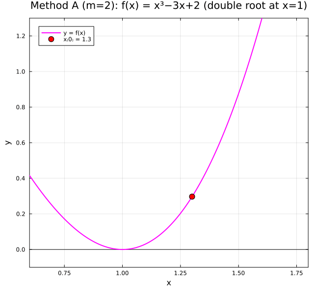
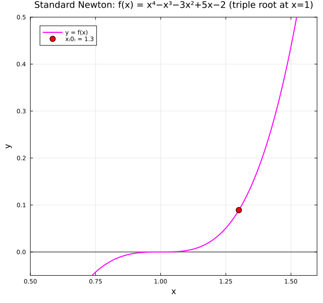

← [Numerical Methods](../)

Source inspiration:  [@mathewsSite].

## Description

The improved Newton methods find a root $x^*$ of $f(x) = 0$ that has multiplicity $m \ge 2$, meaning $f(x) = (x - x^*)^m h(x)$ with $h(x^*) \neq 0$, so that $f'(x^*) = 0$.
There, standard Newton-Raphson, $x_{n+1} = x_n - f(x_n)/f'(x_n)$, still converges from a close enough start, but in general only linearly: with $e_n = x_n - x^*$, $|e_{n+1}| \approx \tfrac{m-1}{m}\,|e_n|$.
[Case 1](#case-1) shows the ratio $1/2$ at a double root and [Case 3](#case-3) the ratio $2/3$ at a triple root; the computed ratios $e_n/e_{n-1}$ reach $0.50005$ and $0.66680$ at the last frame.

Mathews compares three remedies.
Method A (accelerated Newton) multiplies the Newton step by the known multiplicity $m$, and Method B (modified Newton) applies Newton's method to $u = f/f'$, which has a simple root at $x^*$:

$$
\text{A:}\quad x_{n+1} = x_n - m\,\frac{f(x_n)}{f'(x_n)},
\qquad
\text{B:}\quad x_{n+1} = x_n - \frac{f(x_n)\,f'(x_n)}{f'(x_n)^2 - f(x_n)\,f''(x_n)}.
$$

Method C (adaptive Newton) does not need $m$.
It computes $x_{n,m} = x_n - m\,f(x_n)/f'(x_n)$, starting from the Newton step $m = 1$, increases $m$ while $|f(x_{n,m+1})| < |f(x_{n,m})|$, and takes the last such point as $x_{n+1}$.
All three need $f'$, Method B also needs $f''$, and only Method A needs $m$ in advance.

In general, if $h$ is continuously differentiable near $x^*$ and $x_0$ is close enough, Method A converges at least quadratically, with $e_{n+1}/e_n^2 \to h'(x^*)/\bigl(m\,h(x^*)\bigr)$.
Method B, being Newton's method at the simple root of $u$, also converges at least quadratically for smooth enough $f$.
[Case 2](#case-2) and [Case 4](#case-4) show Method A: there $h(x) = x + 2$, and $e_n/e_{n-1}^2$ reaches $0.16666$ and $0.11111$ at the last frame, against the limits $1/6$ and $1/9$.
On both functions Method C picks $m = 2$ and $m = 3$ at each step, reproducing Method A's iterates without being told $m$.

With the wrong multiplicity, Method A is at best linear: at a root of multiplicity $M$, $e_{n+1} \approx (1 - m/M)\,e_n$, so $m = 2$ at the triple root gives the ratio $1/3$, and $m > M$ overshoots to the other side of the root.
Method B's $u = f/f'$ has poles wherever $f'$ vanishes away from a root of $f$, such as $x = -1$ for the function of Cases 1 and 2.
And Methods A and C are built for multiplicity, not for a poor start: on $\arctan x$, whose root is simple, both reduce to standard Newton and diverge from $x_0 = 1.4$, just past $x_c \approx 1.3917$ ([Case 5](#case-5)).
The animations show standard Newton and Method A; Case 5 also discusses Methods B and C.

[Newton-Raphson Method](../newton-raphson-method/) covers the standard iteration and its linear rate at multiple roots, [Accelerated and Modified Newton-Raphson](../accelerated-and-modified-newton-raphson/) treats Methods A and B on their own, and [Halley's Method](../halleys-method/) also uses $f''$, to converge cubically at simple roots.

## Animations

Each animation below traces a Newton-type iteration: Cases 1–4 use functions with a multiple root at $x = 1$, and Case 5 uses $\arctan x$, which has a simple root at $x = 0$.
For standard Newton (Cases 1, 3, 5) each slanted line is the tangent at $x_n$; for Method A (Cases 2, 4) it is the line of slope $f'(x_n)/m$.
Each slanted line runs from $(x_n, f(x_n))$ to the next iterate's x-intercept $(x_{n+1}, 0)$, and each vertical line returns from $(x_{n+1}, 0)$ to the curve at $(x_{n+1}, f(x_{n+1}))$; together they trace the convergence path.
Standard Newton-Raphson degrades to linear convergence at multiple roots; started close enough, Method A (accelerated) restores at least quadratic convergence by multiplying the Newton step by the root's multiplicity $m$.

Julia source scripts that generated these animations are linked under each case.

Cases 1–4 follow Examples 1 and 2 of Mathews' Improved Newton Method module.
The module's Example 3, which compares the methods at a quadruple root, the Method B and Method C iterations of all its examples, and the caveats in Examples 1 and 2 are not animated here; Example 1's caveat plots the rounding noise in the expanded $f$ near the double root, and Example 2's runs Method A with the wrong multiplicity ($m = 2$ at the triple root), which converges only linearly.

### Case 1 — Standard Newton, linear convergence (double root), $f(x) = x^3 - 3x + 2$, $x_0 = 1.3$ {#case-1}

**Behavior:** $f(x) = x^3 - 3x + 2 = (x-1)^2(x+2)$ has a double root at $x^* = 1$.
Because $f'(x^*) = 0$ at a multiple root, the standard convergence proof breaks down.
Each step only halves the error rather than squaring it — the iteration creeps slowly toward $x = 1$ over many steps.

[Julia source](newtonimpaa.jl)

### Case 2 — Method A (accelerated, $m=2$), quadratic convergence, $f(x) = x^3 - 3x + 2$, $x_0 = 1.3$ {#case-2}

**Behavior:** Method A uses $x_{n+1} = x_n - m \cdot \tfrac{f(x_n)}{f'(x_n)}$ with $m = 2$ (the known multiplicity).
The enlarged step compensates for the vanishing derivative at the double root, restoring quadratic convergence.
Compare the rapid convergence here against the slow Case 1 — same function, same starting point, completely different speed.

[Julia source](newtonimpbb.jl)

### Case 3 — Standard Newton, even slower convergence (triple root), $f(x) = x^4 - x^3 - 3x^2 + 5x - 2$, $x_0 = 1.3$ {#case-3}

**Behavior:** $f(x) = (x-1)^3(x+2)$ has a triple root at $x^* = 1$.
The asymptotic error constant for standard Newton at an order-$m$ root is $(m-1)/m$.
For a triple root this is $2/3$, meaning each iterate only reduces the error by $1/3$ — even slower than the double-root case.

[Julia source](newtonimpcc.jl)

### Case 4 — Method A (accelerated, $m=3$), quadratic convergence, $f(x) = x^4 - x^3 - 3x^2 + 5x - 2$, $x_0 = 1.3$ {#case-4}

**Behavior:** Method A with $m = 3$ (the correct multiplicity) restores quadratic convergence at the triple root.
The convergence is dramatic compared to Case 3: the animated iterates are $1.3$, $1.008824$, $1.000009$ and then $x_3$, which is within $10^{-11}$ of the root (labelled 1.0).
This illustrates Method A's advantage: when the multiplicity $m$ is known, the scaled step gives at least quadratic convergence to a root of any order from a close enough start.
Methods B and C do not need $m$.

[Julia source](newtonimpdd.jl)

### Case 5 — Standard Newton diverges, $f(x) = \arctan(x)$, $x_0 = 1.4$ {#case-5}

**Behavior:** $f(x) = \arctan(x)$ has a simple root at $x^* = 0$.
Newton-Raphson converges only when $|x_0| < x_c \approx 1.3917$; starting at $x_0 = 1.4$ — just outside that radius — each tangent line overshoots further than the previous iterate, and the iterates escape toward $\pm\infty$.
Method A with the correct multiplicity ($m = 1$ for this simple root) is standard Newton, so it **does not fix this case**.
Method B (Newton's method applied to $u = f/f' = (1+x^2)\arctan x$) does: $u$ is increasing and convex for $x > 0$, so from $x_0 = 1.4$ its iterates decrease monotonically to the root ($0.6316$, $0.1712$, $0.00625$, $3.25 \times 10^{-7}$, …).
Method C does not fix it: for $\arctan$ the $m = 1$ step always crosses to the other side of $0$ ($x_{0,1} \approx -1.41$ here) and $m = 2$ lands farther out ($x_{0,2} \approx -4.23$, with larger $|f|$), so C keeps $m = 1$ at every step and diverges exactly as standard Newton does.
This is a cautionary example: Methods A and C are designed for multiplicity and do not repair a global-convergence failure like this one.

[Julia source](newtonimpee.jl)

