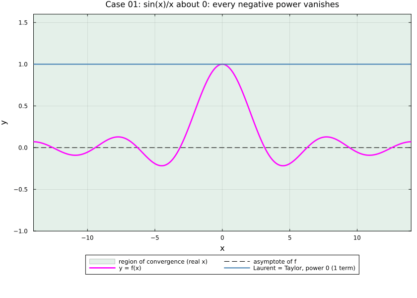
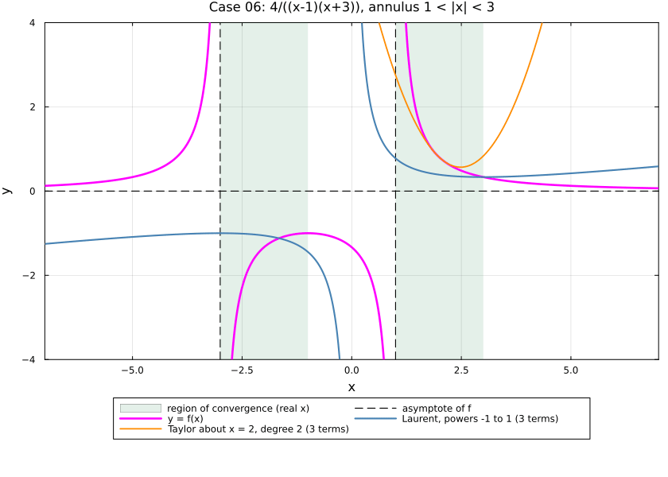
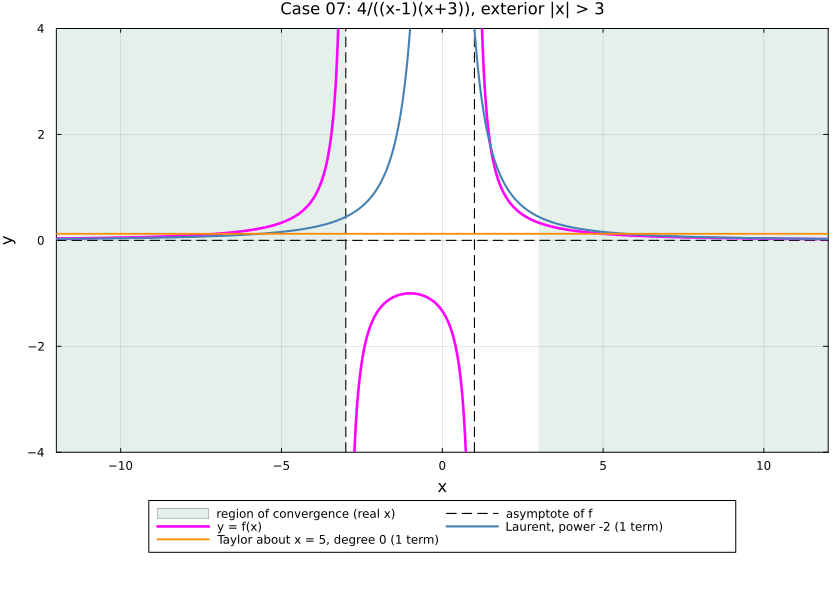
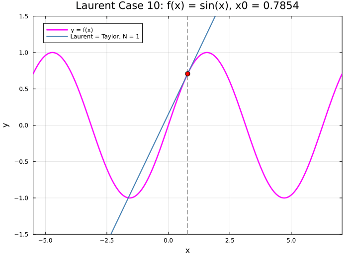
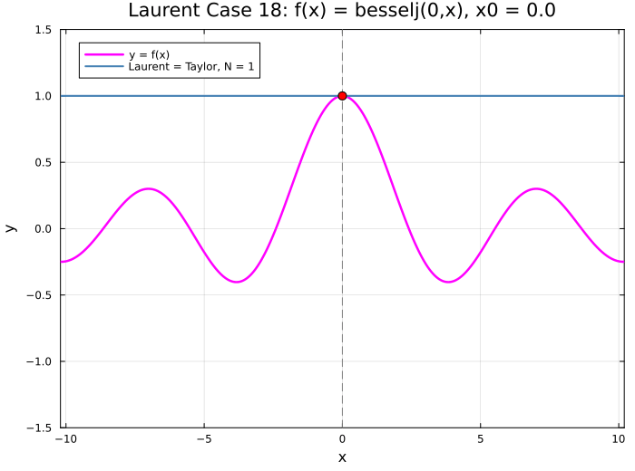
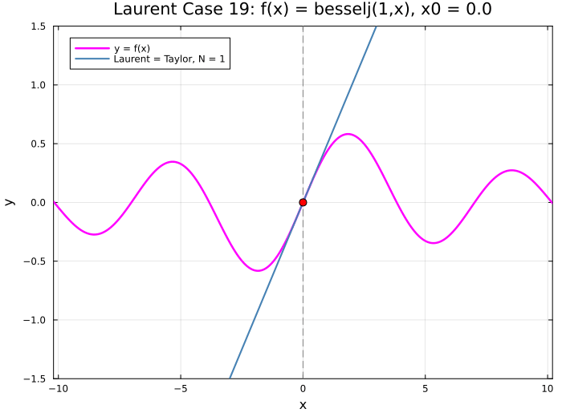
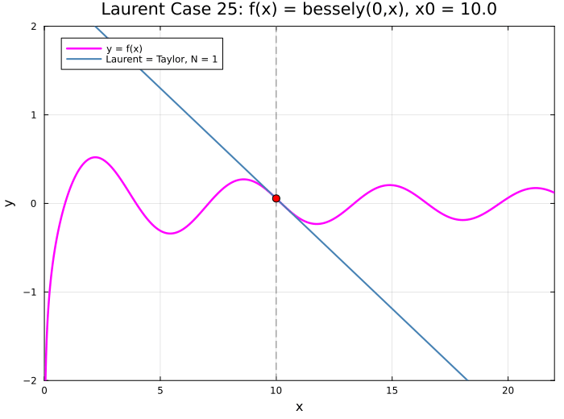
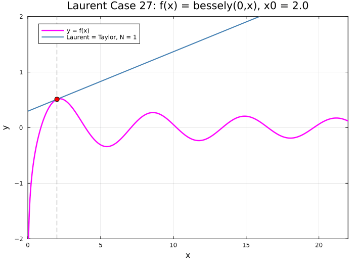

← [Numerical Methods](../)

Source inspiration: [@mathewsSite].

## Description

A Laurent series of a function around a center $x_0$, valid in an annulus $r<|x-x_0|<R$ of the complex plane on which $f$ is analytic, is

$$
f(x)=\sum_{k=-\infty}^{\infty} a_k (x-x_0)^k,
$$

which extends Taylor series by allowing negative powers. Those negative-power terms form the principal part and capture pole-like behavior. When $f$ is analytic at $x_0$, as it is in every case below, its Laurent series on the largest disc $|x-x_0|<R$ on which $f$ is analytic has zero principal part and is the ordinary Taylor series.

## Animations

The Laurent animation for this topic reuses the same 27 function/interval/center cases used on the Padé page, but draws truncated series about $x_0$ instead of rational Padé forms.

All 27 functions are analytic at $x_0$, so on the largest disc about $x_0$ on which $f$ is analytic, $a_k=0$ for every $k<0$, and the two-sided truncation

$$
\sum_{k=-N}^{N} a_k (x-x_0)^k=\sum_{k=0}^{N} a_k (x-x_0)^k
$$

is the degree-$N$ Taylor polynomial. That is what each frame draws, with $N$ increasing frame by frame; no frame contains a negative power. Unless $f$ is entire (cases 08–11, 13–15 and 18–21), the series converges only within the distance from $x_0$ to the nearest singularity of $f$ in the complex plane and diverges beyond it, and every such plotted interval reaches past that distance. Case 03's window passes that distance only on $10<x\le 10.5$, and case 06's on $4<x\le 4.1$ and $-0.5\le x<0$. On $10<x\le 10.5$ (case 03) and $4<x\le 4.1$ (case 06) the ten frames do not show the divergence: the error falls from each frame to the next. At $x=10.5$ in case 03 the error keeps falling until $N=15$, and at $x=4.1$ in case 06 until $N=20$; after that it grows with every further term (checked to $N=80$). In case 06 the divergence shows only for $x<0$, where $\log x$ is not real and no $f$ curve is drawn: there every term after the constant is negative, so the blue curve sinks with each frame and drops below the bottom of the window ($y=-6$) at the left edge in frames 9 and 10 (at $x=-0.5$ the partial sum is $-6.10$ for $N=9$ and $-7.03$ for $N=10$). Where the nearest singularity is a pole ($\tan x$ in case 12, $\Gamma(x)$ in cases 22–24), a different Laurent series about $x_0$, with nonzero negative powers, holds in the annulus between that pole and the next singularity; the animations do not draw it.

Each case below follows the same case ordering as the Padé suite (Case 01 through Case 27).

[Julia source for all cases](laurent_animations_all.jl)

### Case 01 — $f(x)=\sqrt{x}$, $x_0=1$, $x\in[0,10.5]$

### Case 02 — $f(x)=\sqrt{x}$, $x_0=4$, $x\in[0,10.5]$

### Case 03 — $f(x)=\sqrt{x}$, $x_0=5$, $x\in[0,10.5]$

### Case 04 — $f(x)=\dfrac{1}{\sqrt{1-x}}$, $x_0=0$, $x\in[-1.5,1.5]$

### Case 05 — $f(x)=\log(x)$, $x_0=1$, $x\in[-0.5,4.1]$

### Case 06 — $f(x)=\log(x)$, $x_0=2$, $x\in[-0.5,4.1]$

### Case 07 — $f(x)=\log(1+x)$, $x_0=0$, $x\in[-1.5,1.5]$

### Case 08 — $f(x)=\sin(x)$, $x_0=0$, $x\in[-3\pi,3\pi]$

### Case 09 — $f(x)=\cos(x)$, $x_0=0$, $x\in[-3\pi,3\pi]$

### Case 10 — $f(x)=\sin(x)$, $x_0=\pi/4$, $x\in[-7\pi/4,9\pi/4]$

### Case 11 — $f(x)=\cos(x)$, $x_0=\pi/3$, $x\in[-5\pi/3,7\pi/3]$

### Case 12 — $f(x)=\tan(x)$, $x_0=0$, $x\in[-\pi,\pi]$

### Case 13 — $f(x)=e^x$, $x_0=0$, $x\in[-2,3]$

### Case 14 — $f(x)=e^{-x}\cos(x)$, $x_0=0$, $x\in[-2,4]$

### Case 15 — $f(x)=\cosh(x)$, $x_0=0$, $x\in[-4,4]$

### Case 16 — $f(x)=\arctan(x)$, $x_0=0$, $x\in[-2,2]$

### Case 17 — $f(x)=\arcsin(x)$, $x_0=0$, $x\in[-1.5,1.5]$

### Case 18 — $f(x)=J_0(x)$, $x_0=0$, $x\in[-10.2,10.2]$

### Case 19 — $f(x)=J_1(x)$, $x_0=0$, $x\in[-10.2,10.2]$

### Case 20 — $f(x)=\dfrac{1}{\sqrt{2\pi}}e^{-x^2/2}$, $x_0=0$, $x\in[-3,3]$

### Case 21 — $f(x)=\dfrac{1}{2}+\dfrac{1}{2}\operatorname{erf}\!\left(\dfrac{x}{\sqrt{2}}\right)$, $x_0=0$, $x\in[-3,3]$

### Case 22 — $f(x)=\Gamma(x)$, $x_0=1$, $x\in[-0.2,5.2]$

### Case 23 — $f(x)=\Gamma(x)$, $x_0=2$, $x\in[-0.2,5.2]$

### Case 24 — $f(x)=\Gamma(x)$, $x_0=3$, $x\in[-0.2,5.2]$

### Case 25 — $f(x)=Y_0(x)$, $x_0=10$, $x\in[0,22]$

### Case 26 — $f(x)=Y_0(x)$, $x_0=5$, $x\in[0,22]$

### Case 27 — $f(x)=Y_0(x)$, $x_0=2$, $x\in[0,22]$

