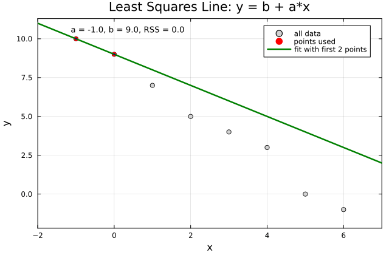
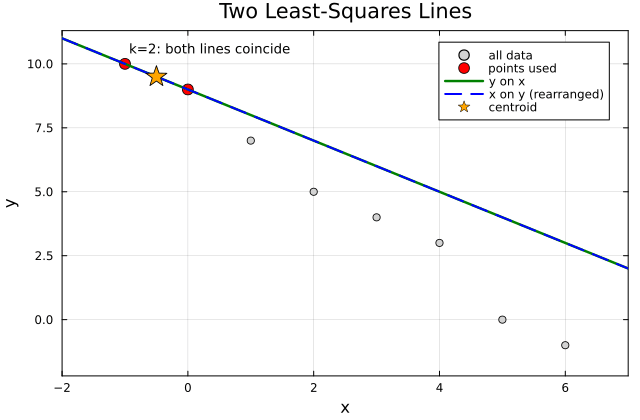

← [Numerical Methods](../)

Source inspiration: [@mathewsSite].

## Description

Least squares line fitting chooses parameters that minimize the sum of squared residuals between measured data and a model. The standard linear model is
$y = b + a x$, where residuals are vertical distances from points to the fitted line.

This module also highlights two important variations:

- Regressing $x$ on $y$ instead of $y$ on $x$ produces a different line after rearrangement, even for the same data.
- Constrained models such as $y = a x$ and $y = a x^{3/2}$ remain linear in the unknown coefficient $a$, so least squares still applies directly.

## Animations

Each animation below shows how the fitted model changes as data points are added. Cases 1, 3 and 4 print the fitted coefficients and the residual sum of squares in each frame, and Cases 1 and 3 also draw each vertical residual as a dark blue segment from the point to the line, so you can see the distances whose squares the least-squares criterion adds up. These data lie close to their lines (the largest residual in any frame is about 0.79 in Case 1 and 0.46 in Case 3), so the segments are short and some are barely visible.

### Case 1 - Standard Least-Squares Line, $y = b + a x$

**Behavior:** The unconstrained fit minimizes vertical residuals to a straight line. With all eight points the fit is $a = -45/28 \approx -1.6071$ and $b = 121/14 \approx 8.6429$. The eighth point $(6, -1)$ lies exactly on the seven-point line, so the last two frames show the same fit.

[Julia source](lslineaa.jl)

### Case 2 - Two Regression Lines and Their Intersection

**Behavior:** With only the first two points, fitting $y$ as a function of $x$ and fitting $x$ as a function of $y$ give the same line, through both points. From three points on they give two distinct lines in the $x$-$y$ plane, and their intersection coincides with the centroid of the points used, which for all eight points is $(\bar{x}, \bar{y}) = (2.5, 4.625)$. These data are strongly correlated, so the two lines nearly overlap: with all eight points their slopes are $-1.6071$ and $-1.6278$.

[Julia source](lslineab.jl)

### Case 3 - Constrained Fit Through the Origin, $y = a x$

**Behavior:** Constraining the intercept to zero changes the optimization geometry and produces a single-parameter fit. With all eight points of the legacy dataset the fit is $a = 157/102 \approx 1.5392$; as points are added the coefficient zig-zags downward from 2.

[Julia source](lslineac.jl)

### Case 4 - Kepler-Style Power Fit, $T = a r^{3/2}$

**Behavior:** With exponent fixed at $3/2$, the power law is linear in $a$ after choosing basis function $r^{3/2}$. Using Mercury, Venus, Earth, and Mars data gives $a \approx 0.19977$. These are the legacy module's data; its Mercury distance of 57.59 million km is about 0.55% below its modern semi-major axis of about 57.91 million km, which is why Mercury's ratio $T/r^{3/2} \approx 0.2013$ stands apart from the other three planets' $0.1997$ to $0.1999$.

[Julia source](lslinead.jl)

## Derivation Notes (Planned)

Short derivations will be added to explain the core equations and assumptions.

## Worked Example (Planned)

A compact numerical example with intermediate steps will be included.

## Implementation Notes (Planned)

Implementation details, numerical stability notes, and practical pitfalls will be added.
