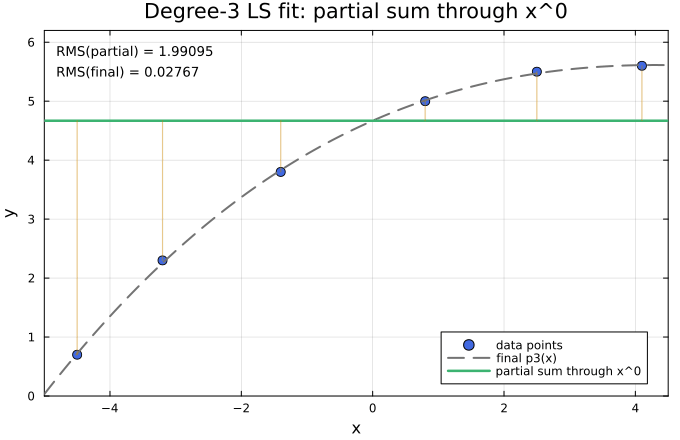
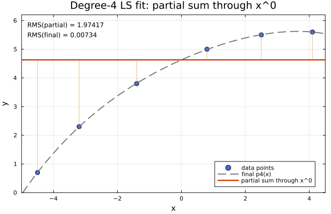

← [Numerical Methods](../)

Source inspiration: [@mathewsSite].

## Description

Given data points $(x_i,y_i)$, the least-squares polynomial of degree $m$

$$p_m(x)=a_0+a_1x+a_2x^2+\cdots+a_mx^m$$

is chosen to minimize the total squared error

$$E(a_0,\ldots,a_m)=\sum_{i=1}^{n}\left(p_m(x_i)-y_i\right)^2.$$

Setting the partial derivatives of $E$ to zero gives the normal equations, which in matrix form are

$$\left(V^T V\right)\mathbf{a}=V^T\mathbf{y},$$

where $V$ is the Vandermonde-style design matrix. Once the coefficients are found, the fit quality is often summarized with the root-mean-square error

$$\mathrm{RMS}=\sqrt{\frac{1}{n}\sum_{i=1}^{n}\left(p_m(x_i)-y_i\right)^2}.$$

The legacy examples on this page use the six data points

$$(-4.5,0.7),\;(-3.2,2.3),\;(-1.4,3.8),\;(0.8,5.0),\;(2.5,5.5),\;(4.1,5.6).$$

As the degree increases from 2 to 5, RMS decreases, but this does not always mean better behavior outside the data interval. High-degree polynomial fits can exhibit oscillations ("polynomial wiggle") and poor extrapolation.

## Animations

Each animation below draws the degree-$m$ least-squares polynomial one partial sum at a time, for the same dataset. The blue points are the data, the gray dashed curve is the fitted polynomial $p_m$, and the solid colored curve is the partial sum $a_0+a_1x+\cdots+a_kx^k$ of its coefficients, with $k$ increasing frame by frame. Only the last frame ($k=m$) is a least-squares fit. The earlier partial sums are not the least-squares fits of degree $k$, because lowering the degree changes every coefficient: the degree-0 fit is the mean $3.8167$, while $a_0$ ranges from $4.629$ to $4.674$ across the four cases. Each of these earlier partial sums has a larger RMS than the degree-$k$ least-squares fit, and its RMS need not fall as terms are added: in Case 4 it rises from $0.17774$ at $k=2$ to $0.20267$ at $k=3$.

Julia source scripts, which compute the coefficients from the normal equations and generated these animations, are linked under each case.

### Case 1 - Quadratic fit, $m=2$

**Behavior:** The quadratic captures the main concave-down trend well, with all residuals below $0.1$ in size; the two largest are at the two leftmost points ($x=-4.5$ and $x=-3.2$). This is the baseline smooth fit used in the module.

$$p_2(x)=4.67425 + 0.52861x - 0.07563x^2,\qquad \mathrm{RMS}\approx 0.05245.$$

[Julia source](leastsqpolyaa.jl)

### Case 2 - Cubic fit, $m=3$

**Behavior:** Adding the cubic term improves local flexibility and lowers RMS. The fit tracks the left and right tails a bit more closely while remaining stable across the plotted interval.

$$p_3(x)=4.66863 + 0.48939x - 0.07424x^2 + 0.00268x^3,\qquad \mathrm{RMS}\approx 0.02767.$$

[Julia source](leastsqpolyab.jl)

### Case 3 - Quartic fit, $m=4$

**Behavior:** The quartic noticeably reduces residuals and follows the subtle curvature changes between middle and right-side points. RMS drops by about a factor of four compared with the cubic.

$$p_4(x)=4.62863 + 0.49669x - 0.05823x^2 + 0.00201x^3 - 0.00080x^4,\qquad \mathrm{RMS}\approx 0.00734.$$

[Julia source](leastsqpolyac.jl)

### Case 4 - Quintic fit, $m=5$

**Behavior:** With six data points at distinct $x$ values and degree 5, the least-squares polynomial interpolates all six points, so its RMS is exactly 0; the animation's floating-point solve shows roundoff of about $8\times 10^{-15}$. This illustrates why a degree-$n-1$ polynomial can match $n$ distinct points, but it may still be fragile for extrapolation.

$$p_5(x)=4.63232 + 0.50885x - 0.06063x^2 - 0.00074x^3 - 0.00065x^4 + 0.00012x^5,\qquad \mathrm{RMS}=0\ \text{(exact interpolation)}.$$

[Julia source](leastsqpolyad.jl)

