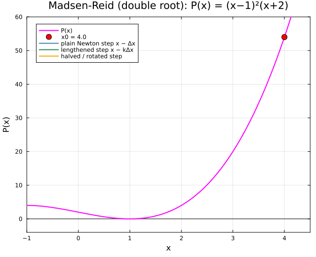
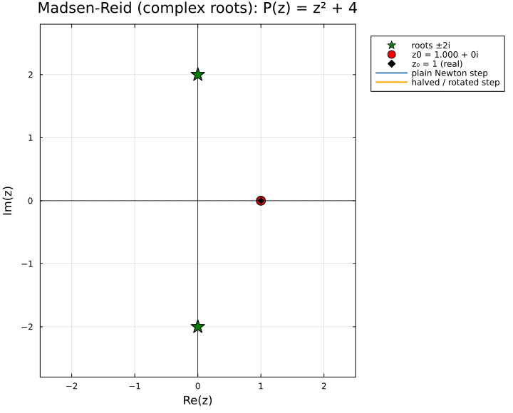

← [Numerical Methods](../)

## Description

The **Madsen-Reid method** [@madsenReid1975] is a robust, globally convergent Newton-based algorithm for finding all roots of a real-coefficient polynomial. This page follows Madsen's method as implemented by Vestermark: the scripts port the iteration of `newton_real` ([Newton_Real.cpp](https://www.hvks.com/Numerical/Downloads/Newton_Real.cpp), Future Team ApS, 2002) with one correction (Stage 2, below), and the description below is of that implementation. It combines three complementary ideas into a single, practical solver:

### 1. Lengthened steps at multiple roots

Standard Newton-Raphson degrades to *linear* convergence at a root of multiplicity $m > 1$ because $f'(x^*) = 0$: near the root $f/f' \approx (x-x^*)/m$, so each Newton step covers only $1/m$ of the remaining distance and the error shrinks by the factor $(m-1)/m$ per step. Madsen-Reid counters this by taking **multiple steps in the same direction**: in Stage 1 (below), when the Newton point $z - \Delta z$ does not increase $|f|^2$, it also tries $z - 2\Delta z,\ z - 3\Delta z, \dots$ (up to $z - (n+1)\,\Delta z$ for a polynomial of degree $n$), stops at the first trial that does not lower $|f|^2$, and keeps the trial before it. Near a root of multiplicity $m$ that point is $z - m\,\Delta z$, the multiplicity-corrected Newton step, so the convergence to a multiple root is quadratic while the iteration stays in Stage 1 (in Case 2, until rounding error takes over). Only Stage 1 searches, though: Stage 2 takes plain Newton steps, which are linear at a multiple root. Near a double root the two sides of the stage test (below) tend to equality, so whether a run stays in Stage 1 depends on the run. Case 2 stays in Stage 1 throughout. Started at $x_0 = -0.7$ instead of 4, the same polynomial takes a plain Newton step past the root to $x_1 \approx 1.7556$, then one Stage-2 step to $x_2 \approx 1.4123$ (the error falls from 0.76 to 0.41). The stage test then fails (its left side is 1.24 times its right side), and three lengthened Stage-1 steps with $k = 2$ take the error to $2.3 \times 10^{-2}$, $9.1 \times 10^{-5}$ and $1.4 \times 10^{-9}$, where the computed $|f|^2$ is exactly 0 and the run stops after 5 steps.

A separate safeguard limits the Newton step to length $r_0$, which is reset after each Newton step to five times that step's length before the cap:

$$r_0 \leftarrow 5\,|\Delta z|$$

A Newton step longer than $r_0$ is cut to length $r_0$ and rotated by $53.13°$ by `alterdirection` (below); a rotation would take Cases 1 and 2 off the real axis, and their scripts stop with an error if one occurs. No Newton step in the three animations is longer than $r_0$, so the cap never acts.

### 2. Safety — the two stages

Each iteration computes the Newton step $\Delta z = f(z)/f'(z)$, caps it at $r_0$, and takes it in one of two stages:

- **Stage 1 (checked steps)** compares $|f|^2$ at trial points along the step. If $z - \Delta z$ does not increase $|f|^2$, the lengthening search above runs. If it does, the step is halved, and each halving is kept only while it lowers $|f|^2$ below the previous trial. If two halvings both help, the iterate is taken to be near a saddle point: `alterdirection` rotates the step by $53.13°$ and halves it once more (multiplication by $0.5\,(0.6 + 0.8i)$), and that point is accepted. The rotation makes the step complex, so it can only be shown in Case 3.
- **Stage 2 (plain Newton)** takes $z - \Delta z$ with no trial points, and ends the run once $|f(z)|$ is no larger than Adams' bound on the rounding error of $f(z)$. It is used only when the previous step was a plain Newton step (the Stage-1 search left it unchanged) and the test $2\,|f(z_k)|\,|w| \le |f'(z_k)|^2\,|z_{k-1} - z_k|$ passes. Here $w = f'(z_{k-1}) - f'(z_k)$, so $w/(z_{k-1} - z_k)$ estimates $f''$ and the test estimates Kantorovich's condition $2|f|\,|f''| \le |f'|^2$ for Newton's method to converge. The scripts follow `newton_real` except in one line: after each step they store the derivative $f'(z_{k-1})$ for $w$, as Madsen and Reid's test (2.9) requires [@madsenReid1975] and the reference's own initial value $f'(0)$ implies, where `newton_real` stores $f(z_{k-1})$.

Two further branches handle a true saddle point ($f'(z) = 0$: the previous step is rotated by $53.13°$ and lengthened 5 times) and the rounding-error domain (when a Newton step shorter than $2^{-26}|z|$ does not lower $|f|^2$, it is retried from its starting point, rotated and halved). Neither is reached in the three animations.

The two-stage structure is designed to make $|f(z)|^2$ decrease at every step, without requiring a full line search. It is not a guarantee: each halving is compared with the previous trial rather than with $|f(z_k)|^2$, the rotated step is accepted without a check, and Stage-2 steps are not checked at all. In all three animations below $|f|^2$ does decrease at every step.

### 3. Efficiency — minimizing function evaluations

Higher-order methods (Halley's, Householder's) achieve cubic or higher convergence but require evaluating $f''$, $f'''$, etc. Madsen-Reid achieves rapid convergence using only **$f$ and $f'$** — the same derivatives as plain Newton, plus a few extra evaluations of $f$ at the trial points — while the acceleration mechanism and dual-stage control make it far more reliable than unguarded Newton on difficult polynomials.

After each root is found, the polynomial is deflated (divided out), reducing the degree by 1 (real root) or 2 (complex conjugate pair), until the remaining linear or quadratic factor is solved analytically.

> **Note on generalization:** Only part of this structure carries over to equations that are not polynomials. For a real equation $f(x) = 0$, the descent test on $|f|^2$, the lengthening and halving of the Newton step and the Kantorovich-style switch to plain Newton need only $f$ and $f'$ in real arithmetic; Cases 1 and 2 never leave the real axis. The lengthening bound $n + 1$ and Adams' stopping bound come from the polynomial's degree and coefficients, so a general $f$ needs its own. The $53.13°$ rotation multiplies the step by the complex number $0.6 + 0.8i$, so it needs an $f$ that can be evaluated off the real axis, as a polynomial can (Case 3 uses it); it has no counterpart for a real equation on the real axis, and the method defines none for a system $\mathbf{F}(\mathbf{x}) = \mathbf{0}$.

## Animations

Each animation shows the **iteration path** of the Madsen-Reid method. Blue segments are plain Newton steps $z - \Delta z$; green segments are lengthened steps $z - k\,\Delta z$ with $k \ge 2$, drawn as the tangent line down to the Newton point and then along the axis; orange segments are halved or rotated steps. The label of the current point names the stage of the step that reached it. Cases 1 and 2 start from their own $x_0$ with $r_0 = 5|x_0|$ rather than from the reference's start-point rule; Case 3 starts where the reference does. In Case 3, star markers show the exact roots.

Julia source scripts that generated these animations are linked under each case.

### Case 1 — Simple root, $P(x) = x^3 - 3x - 1$, $x_0 = 3.0$

**Behavior:** Three simple real roots exist. Starting from $x_0 = 3.0$, the doubled step reduces $|P|^2$ more than the Newton step does, and the tripled step does not ($|P|^2$ = 17.3, 3.17 and 8.73 for $\Delta x$, $2\Delta x$ and $3\Delta x$), so the first move is the lengthened step $x_1 = x_0 - 2\Delta x \approx 1.5833$ (green), which passes the root. Every later step is a plain Newton step (blue): step 2 is checked in Stage 1, and steps 3 to 6 are Stage-2 steps. No step is halved. Because $P'(x^*) \neq 0$, the convergence to the root $x^* \approx 1.8794$ is quadratic: the error falls $9.8 \times 10^{-2}$, $6.4 \times 10^{-3}$, $3.0 \times 10^{-5}$, $6.7 \times 10^{-10}$ over steps 2 to 5, and $x_6$ equals $x^*$ to double precision; there $|P|$ is below Adams' bound and the run stops.

[Julia source](madsreidaa.jl)

### Case 2 — Double root, $P(x) = (x-1)^2(x+2)$, $x_0 = 4.0$

**Behavior:** $P(x)$ has a double root at $x^* = 1$ where $P'(x^*) = 0$. Standard Newton-Raphson converges only linearly here: from $x_0 = 4$ its error roughly halves each step and is still $3.4 \times 10^{-4}$ after 14 steps. Madsen-Reid takes a lengthened step every time (all green, all in Stage 1: the run starts in Stage 1, and a lengthened step never leads to Stage 2): $3\Delta x$ to $x_1 = 0.4$, past the root, then $2\Delta x$, the multiplicity-corrected step for $m = 2$, four times. The errors $8.6 \times 10^{-2}$, $1.2 \times 10^{-3}$, $2.3 \times 10^{-7}$ of $x_2$ to $x_4$ fall quadratically. The fifth step reaches $x_5 \approx 0.99999999952$ (error $4.8 \times 10^{-10}$), where rounding makes the computed $|P(x_5)|^2$ exactly 0 (its true value is about $4.8 \times 10^{-37}$), so the run stops. No step is halved. From $x_2$ on, the window zooms in on each new step, because the steps shrink from $0.69$ to $2.3 \times 10^{-7}$ in $x$; each zoomed frame shows the tangent reaching the axis halfway along the step, then the second $\Delta x$ along the axis.

[Julia source](madsreidab.jl)

### Case 3 — Complex conjugate roots, $P(z) = z^2 + 4$, $z_0 = 1 + 0i$

**Behavior:** The roots are $z^* = \pm 2i$ — there are no real roots. The reference solves a quadratic in closed form, so this case runs its iteration loop on $z^2 + 4$ directly, from the reference's own start $z_0 = 1$ with $r_0 = 5$. The full Newton step to $-1.5$ increases $|P|^2$ (39.1 against 25), and one halving reaches $z_1 = -0.25$ (a second halving, to $0.375$, does not help). At $z_1$ the full step to $7.875$ increases $|P|^2$ again, and two halvings both help (to $3.8125$, then $1.78125$), so `alterdirection` rotates the step and halves it once more: $z_2 = 0.359375 + 0.8125i$, off the real axis. Orange segments are the halved steps 1 and 3 and the rotated step 2. Step 4 is a plain Newton step checked in Stage 1, and steps 5 to 8 are Stage-2 plain Newton steps (blue), converging quadratically to $z^* = +2i$; the run stops at $z_8$, where $|P| \approx 3.2 \times 10^{-30}$ is below Adams' bound. No lengthened step occurs. The path is a polyline. This case illustrates how the algorithm handles polynomials with no real roots starting from a real initial guess.

[Julia source](madsreidac.jl)

## References

::: {#refs}
:::
