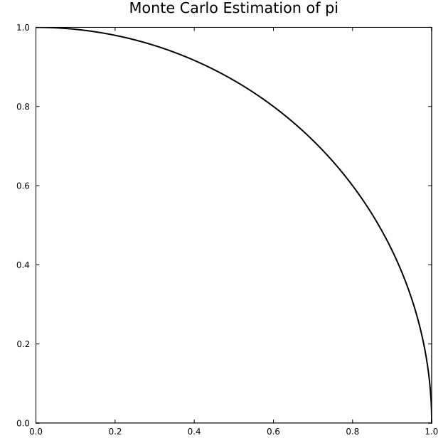

← [Numerical Methods](../)

Source inspiration: [@mathewsSite].

## Description

Monte Carlo estimation of $\pi$ samples random points uniformly in the unit square
$[0,1]\times[0,1]$ and counts how many lie inside the quarter unit disk
$x^2+y^2\le 1$.
If $n$ points are sampled and $m$ of them satisfy the disk test, then
$$
\hat\pi_n = 4\frac{m}{n}.
$$

The stochastic error decreases on the order of $1/\sqrt{n}$, so convergence is slower than high-order deterministic quadrature but robust in higher-dimensional settings.

## Animations

Each animation below shows the **Monte Carlo point-cloud estimator** for
$\pi$ in the quarter-disk geometry. Frames follow the worked-example sample sizes
$n=100, 400, 1600, 6400, 10000$.

Julia source scripts that generated these animations are linked under each case.

No archived animation GIF is available for this topic in the current snapshot, so the animation below is reconstructed from Example 1 of Mathews' Monte Carlo Pi module.
The module's Examples 2–7, which use the same hit-or-miss method of counting the random points that land in the region to estimate areas under curves (Examples 2–5), the area of a cardioid (Example 6) and the area of a region bounded by inequalities (Example 7), are not animated here.

### Case 1 — Monte Carlo $\pi$ Estimation, Quarter Unit Disk in $[0,1]^2$

**Behavior:** After the opening frame (quarter circle only, no points), each frame adds points, green inside $x^2+y^2\le 1$ and orange outside, and prints the estimate $\hat\pi_n$, which fluctuates but trends toward $\pi$ as $n$ increases. Each of these five frames also prints the standard error $4\sqrt{p(1-p)/n}$ with $p=\pi/4$ (about $1.642/\sqrt{n}$), the standard deviation of $\hat\pi_n$; in this seeded run $|\pi-\hat\pi_n|$ is between 0.68 and 1.35 standard errors in each of them.

[Julia source](montecarlopiaa.jl)

