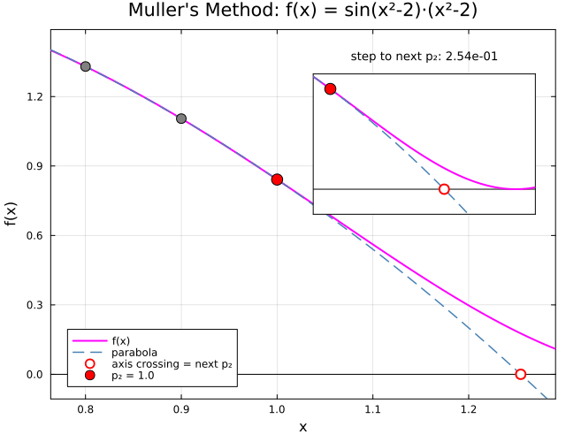

← [Numerical Methods](../)

Source inspiration: [@mathewsSite].

## Description

Muller's method solves a single equation $f(x) = 0$, and it can find complex roots as well as real ones.
Like the [Secant Method](../secant-method/), it uses only values of $f$, not its derivative.
Where the secant method draws a line through two points, Muller's method draws a parabola through three, $p_0$, $p_1$ and $p_2$, and takes the next iterate where the parabola crosses the x-axis.

Write the parabola as $P(x) = f(p_2) + b\,(x - p_2) + d\,(x - p_2)^2$.
Its coefficients come from divided differences of the three points,

$$
h_0 = p_1 - p_0, \quad h_1 = p_2 - p_1, \quad \delta_0 = \frac{f(p_1) - f(p_0)}{h_0}, \quad \delta_1 = \frac{f(p_2) - f(p_1)}{h_1}, \quad d = \frac{\delta_1 - \delta_0}{h_1 + h_0}, \quad b = \delta_1 + h_1 d,
$$

and the next iterate is the root of $P$ nearest $p_2$:

$$
p_3 = p_2 - \frac{2 f(p_2)}{b \pm \sqrt{b^2 - 4 f(p_2)\, d}},
$$

with the sign chosen to make the denominator larger in magnitude, which picks that nearer root and avoids subtracting nearly equal numbers.
The oldest point is then dropped and the step repeats with $(p_1, p_2, p_3)$, so each step costs one new value of $f$.

The three starting points must be distinct, and no sign change or bracket is needed.
Convergence is only local: the starting points must be close enough to the root.
In general, if $f \in C^3$ near a simple root $p$ ($f'(p) \neq 0$) and the iterates converge to it, the errors $e_n = p_n - p$ satisfy

$$
e_{n+1} \approx -\frac{f'''(p)}{6 f'(p)}\, e_n\, e_{n-1}\, e_{n-2},
$$

so the order is about 1.84, the real root of $\alpha^3 = \alpha^2 + \alpha + 1$.
That is faster than the secant method's 1.62 and, as Mathews puts it, almost as fast as Newton's method.
All three cases on this page have double roots instead, where the order drops: in [Case 2](#case-2) and [Case 3](#case-3) the computed order settles near 1.23 as the iteration continues past the frames shown.
That is still superlinear, while Newton's method is only linear at a double root.

The parabola need not cross the x-axis at all.
Then $b^2 - 4 f(p_2)\, d < 0$ and the next iterate is complex, so a program that uses only real arithmetic cannot take the step.
In [Case 1](#case-1) this happens at every step; the animation takes the parabola's vertex instead, and Mathews' program drops the square root.
With complex arithmetic the method itself goes on from the same start: its iterates leave the real line (the first is $1.2873 + 0.3563i$) and still converge to the double root $p = 1$.

The [Newton-Raphson Method](../newton-raphson-method/) needs $f'$ and converges quadratically at simple roots, [Accelerated and Modified Newton-Raphson](../accelerated-and-modified-newton-raphson/) restore that rate at multiple roots, [Brent's Method](../brents-method/) fits a parabola in the other direction (inverse quadratic interpolation) inside a sign-change bracket, and the [Lin-Bairstow Method](../lin-bairstow-method/) reaches complex roots of polynomials using only real arithmetic.

## Animations

Each animation below shows **Muller's Method** fitting a parabola through three successive approximations of a root. The parabola (dashed blue) passes through the current triple $(p_0, p_1, p_2)$, and the next iterate is found where the parabola crosses the x-axis (in Case 1 the parabola never reaches the axis; see that case). Each frame advances one iteration: the oldest point is dropped, and the new root estimate becomes $p_2$ (red dot). The gray dots are $p_0$ and $p_1$.

Julia source scripts that generated these animations are linked under each case.

### Case 1 — Convergent, $f(x) = x^3 - 3x + 2$, double root at $p = 1$ {#case-1}

**Behavior:** The iterates converge to the double root $p = 1$ of $f(x) = (x-1)^2(x+2)$, starting from $p_2 = 2.0$. None of the parabolas reaches the x-axis: at every step its roots are complex, so Muller's next iterate would be complex (the first would be $p_3 \approx 1.2873 + 0.3563i$). This animation takes the real part of that complex root instead, which is the parabola's vertex (open red circle). Each frame is zoomed to the current points, and the inset shows the vertex, whose height above the axis falls from 0.80 to $5.4 \times 10^{-13}$ over the eight frames. The iterates $1.2873, 1.1581, 1.0552, 1.0100, 1.0017, \ldots$ decrease to $p = 1$ superlinearly (order $\approx 1.32$ asymptotically for this real-part variant), faster than Newton's method, which converges only linearly at a double root. Mathews' own program [@mathewsSite] handles the complex case differently: it drops the square root, so the step is $p_3 = p_2 - 2f(p_2)/b$, where $b$ is the parabola's slope at $p_2$. His program also keeps the two points nearest the new iterate rather than the two most recent, and its iterates $1.1091, 1.4944, 1.0558, 0.9965, \ldots$ rise to 1.4944, drop below 1, and then approach 1 from both sides.

[Julia source](mullersaa.jl)

### Case 2 — Convergent, $f(x) = \sin(x^2 - 2)(x^2 - 2)$, double root at $p = \sqrt{2}$ {#case-2}

**Behavior:** The method converges to the double root $p = \sqrt{2} \approx 1.4142$ starting from $p_2 = 1.0$. The function has a double root where $x^2 - 2 = 0$ since both factors vanish simultaneously, and Muller's method locates it efficiently despite the flat tangent at the root. Each frame is zoomed to the current points, and the inset shows the step from $p_2$ to the parabola's axis crossing (open red circle), which is the next iterate; the step shrinks from 0.25 to $3.6 \times 10^{-5}$ over the nine frames.

[Julia source](mullersbb.jl)

### Case 3 — Convergent, $f(x) = x^6 - 7x^4 + 15x^2 - 9$, double root at $p = \sqrt{3}$ {#case-3}

**Behavior:** The function factors as $(x^2-1)(x^2-3)^2$, giving a double root at $p = \sqrt{3} \approx 1.7321$. Starting from $p_2 = 1.5$, Muller's method converges to the double root. Newton's method would converge linearly here; Muller's method converges superlinearly, with order $\approx 1.23$ at this double root (below the $\approx 1.84$ it achieves at a simple root). Each frame is zoomed to the current points, and the inset shows the step from $p_2$ to the parabola's axis crossing (open red circle), which is the next iterate; the step shrinks from 0.13 to $5.5 \times 10^{-5}$ over the nine frames.

[Julia source](mullerscc.jl)

