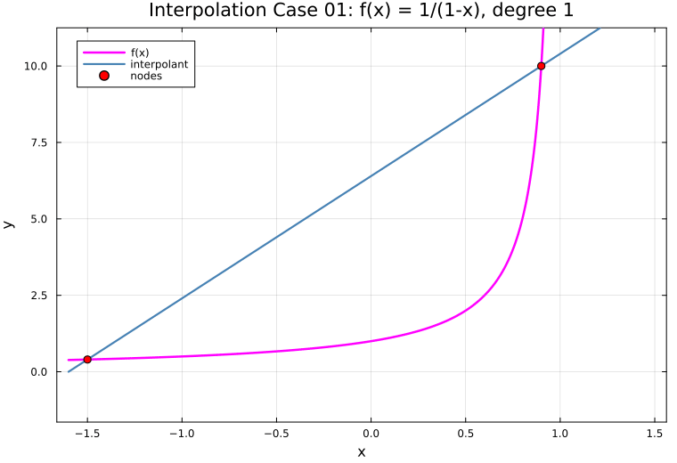
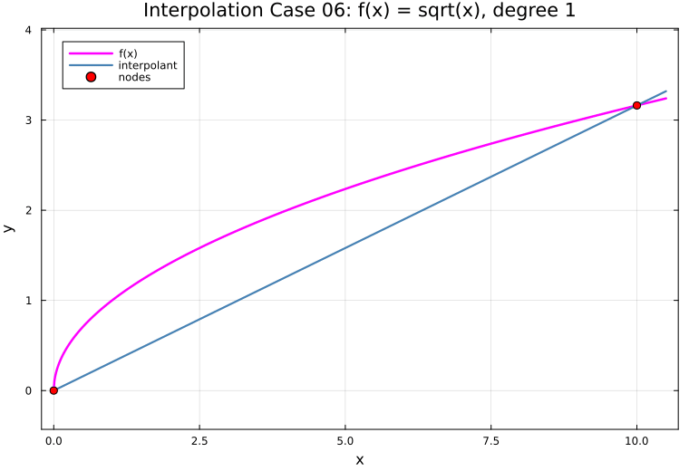
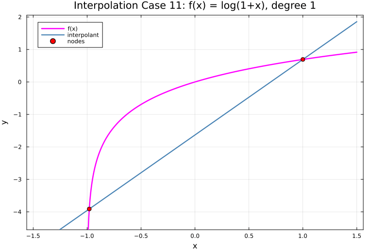
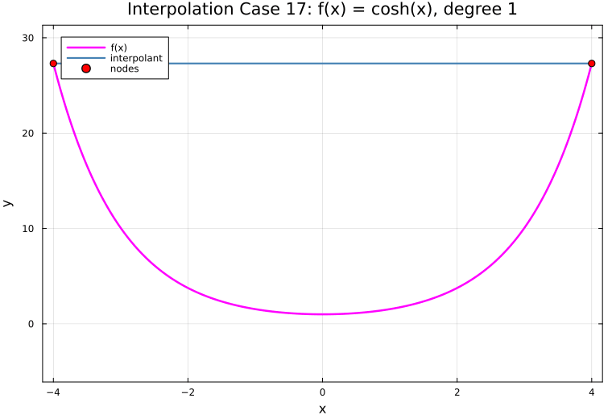
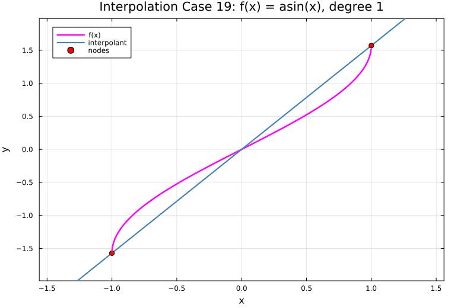
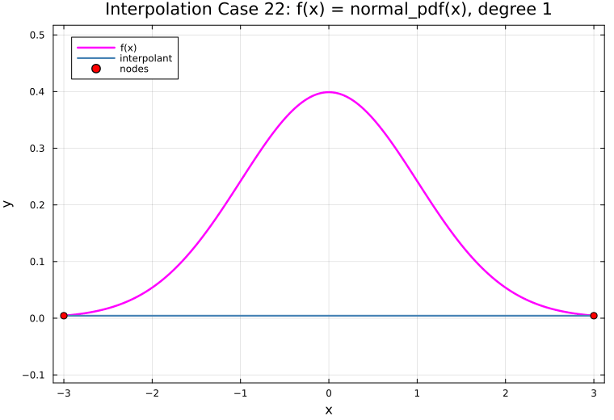
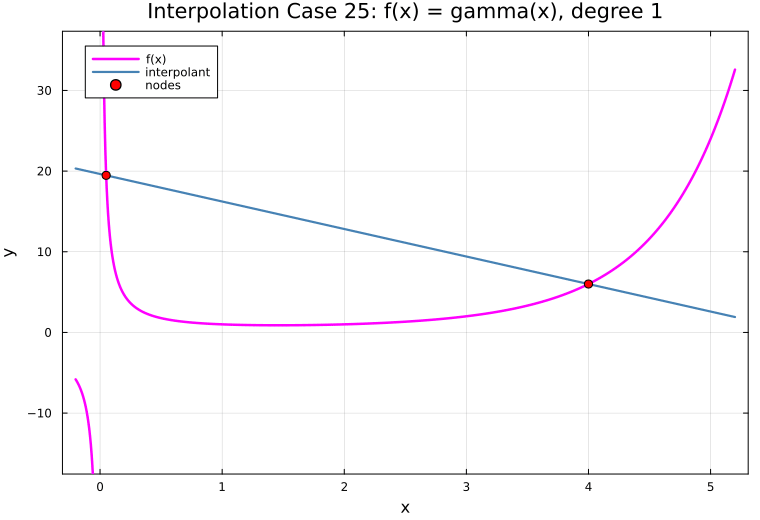
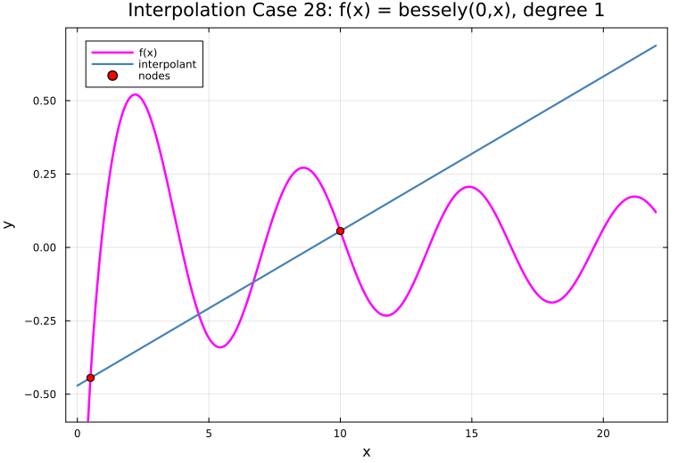

← [Numerical Methods](../)

Source inspiration: [@mathewsSite].

## Description

Newton interpolation represents the interpolating polynomial in divided-difference form,

$$
P_n(x)=a_0 + a_1(x-x_0)+a_2(x-x_0)(x-x_1)+\cdots+a_n\prod_{j=0}^{n-1}(x-x_j),
$$

where $a_k=f[x_0,\ldots,x_k]$ are divided differences. For the same nodes and data, Newton and Lagrange forms produce the same polynomial; they differ only in representation and numerical workflow.

Cases 01–29 below intentionally reuse the same interpolation cases as the [Lagrange page](../lagrange-polynomial-interpolation-and-approximation/index.qmd), matching the legacy Mathews case ordering; the Lagrange page gives each case's function and node interval.

## Animations

Cases 01–29 each show the interpolant on 2, 3, 4, 5, 6, 8, 10, 12, 14 and 16 equally spaced nodes (degree 1 to 5, then 7, 9, 11, 13 and 15) for a fixed function and node interval, with nodes at both ends of the interval.

The shared script draws this same polynomial but evaluates it in the first barycentric (Lagrange) form, not by divided differences. The last case on this page has its own script, which builds the Newton form from divided differences.

[Julia source for Cases 01–29](lagnewt_animations_all.jl)

### Case 01

### Case 02

### Case 03

### Case 04

### Case 05

### Case 06

### Case 07

### Case 08

### Case 09

### Case 10

### Case 11

### Case 12

### Case 13

### Case 14

### Case 15

### Case 16

### Case 17

### Case 18

### Case 19

### Case 20

### Case 21

### Case 22

### Case 23

### Case 24

### Case 25

### Case 26

### Case 27

### Case 28

### Case 29

### Divided differences: $f(x)=\cos x$, nodes $x_k = k\pi/3$ on $[0, 2\pi]$

**Behavior:** Each frame adds the next node and one more Newton term $a_n\prod_{j<n}(x-x_j)$; the coefficients already found do not change. The divided differences are $a_0,\ldots,a_6 = 1,\ -\tfrac{3}{2\pi},\ -\tfrac{9}{4\pi^2},\ \tfrac{9}{2\pi^3},\ -\tfrac{27}{16\pi^4},\ -\tfrac{81}{80\pi^5},\ \tfrac{81}{80\pi^6}$. For degrees 1 to 4 the polynomial leaves the plot to the right of the newest node; with all seven nodes (degree 6) the largest error on $[0, 2\pi]$ is 0.0071.

[Julia source](newtpolyaa.jl)

![Newton interpolation of cos x on [0, 2π], adding one node x_k = kπ/3 per frame from degree 0 (1 node) to degree 6 (7 nodes); the dashed polynomial passes through every node and matches cos x within 0.0071 at degree 6.](newtpolyaa.gif)

## Derivation Notes (Planned)

Short derivations will be added for divided differences, nested evaluation, and incremental updates.
