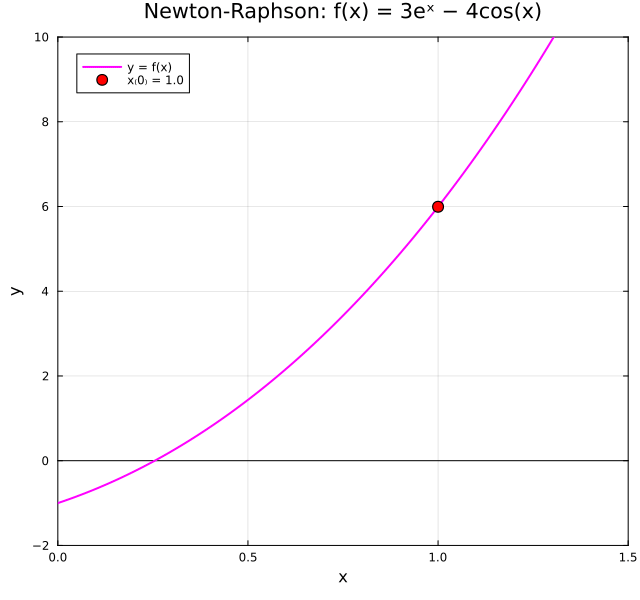
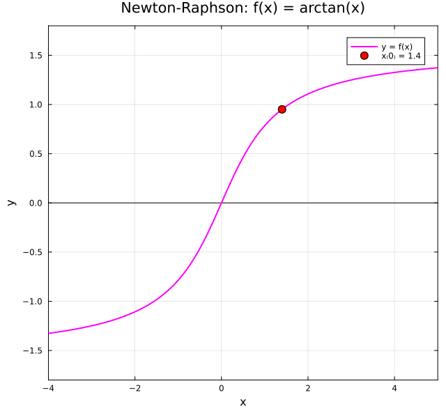

← [Numerical Methods](../)

Source inspiration:  [@mathewsSite].

## Description

The Newton-Raphson method solves a single equation $f(x) = 0$.
From a starting guess $x_0$, each step replaces $f$ by its tangent line at $x_n$, the linear part of its Taylor expansion, and solves that linear equation instead:

$$
x_{n+1} = x_n - \frac{f(x_n)}{f'(x_n)}, \qquad n = 0, 1, 2, \ldots
$$

The method needs $f'(x)$ as well as $f(x)$, and $f'(x_n) \neq 0$ at every iterate; otherwise the tangent line is horizontal and the step is undefined.
Mathews' Newton-Raphson theorem gives the guarantee: if $f \in C^2[a, b]$, $f(x^*) = 0$ for some $x^* \in [a, b]$, and $f'(x^*) \neq 0$, then there is a $\delta > 0$ such that the iterates converge to $x^*$ for every $x_0 \in [x^* - \delta, x^* + \delta]$.
The theorem does not say how large $\delta$ is, so in practice $x_0$ must simply be close enough to the root.

In general, write $e_n = x_n - x^*$.
If the iterates converge to a simple root ($f'(x^*) \neq 0$) and $f$ is in $C^2$ near it, the convergence is at least quadratic:

$$
|e_{n+1}| \approx \frac{|f''(x^*)|}{2\,|f'(x^*)|}\,|e_n|^2 \quad \text{for large } n,
$$

so the number of correct digits roughly doubles each step.
If $x^*$ is instead a root of multiplicity $m \ge 2$, so that $f'(x^*) = 0$, the convergence is only linear, with $|e_{n+1}| \approx \tfrac{m-1}{m}\,|e_n|$.
[Case 1](#case-1) shows the quadratic rate; the table below gives its iterates.
[Case 2](#case-2) shows the linear rate: $f(x) = (1-5x)^2$ has a double root at $x^* = 0.2$, and the iteration reduces to $x_{n+1} - 0.2 = \tfrac12 (x_n - 0.2)$, exactly the ratio $(m-1)/m = 1/2$.

For Case 1, $f(x) = 3e^x - 4\cos(x)$ with $x_0 = 1$, the root is $x^* = 0.254850059029$ to 12 decimals.
From $n = 2$ on, the exponent of the error roughly doubles at each step ($-2, -4, -7, -13$), and $e_n / e_{n-1}^2$ settles at $f''(x^*) / \bigl(2 f'(x^*)\bigr) \approx 0.7933$:

| $n$ | $x_n$ | $e_n = x_n - x^*$ | $e_n / e_{n-1}^2$ |
|---|---|---|---|
| 0 | 1 | $7.45 \times 10^{-1}$ | — |
| 1 | 0.479752015606 | $2.25 \times 10^{-1}$ | 0.4050 |
| 2 | 0.285738359131 | $3.09 \times 10^{-2}$ | 0.6107 |
| 3 | 0.255576900472 | $7.27 \times 10^{-4}$ | 0.7618 |
| 4 | 0.254850477734 | $4.19 \times 10^{-7}$ | 0.7926 |
| 5 | 0.254850059029 | $1.39 \times 10^{-13}$ | 0.7933 |

Convergence is only local, and farther from the root the iterates can fail.
On $f(x) = x^3 - x + 3$, starting from $x_0 = 0$, they are drawn into an attracting 4-cycle and never approach the real root ([Case 4](#case-4)).
On $f(x) = xe^{-x}$, starting from $x_0 = 2$, they run off to $+\infty$ while $f(x_n) \to 0$, so a stopping test on $|f(x_n)|$ alone would eventually accept a point far from any root ([Case 5](#case-5)).
On $f(x) = \arctan(x)$, $x_0 = 1.35$ converges, but $x_0 = 1.4$, just past $x_c \approx 1.3917$, diverges in oscillations of growing size ([Case 3](#case-3), [Case 6](#case-6)).

The [Secant Method](../secant-method/) replaces $f'(x_n)$ by the slope through the last two iterates, [Bisection](../bisection-method/) and [False Position](../false-position-or-regula-falsi-method/) keep a sign-change bracket around the root and converge more slowly but cannot lose it, [Fixed Point Iteration](../fixed-point-iteration/) contains Newton-Raphson as the case $g(x) = x - f(x)/f'(x)$, [Accelerated and Modified Newton-Raphson](../accelerated-and-modified-newton-raphson/) restore quadratic convergence at multiple roots, [Halley's Method](../halleys-method/) uses $f''$ as well to converge cubically at simple roots, and [Nonlinear Systems](../nonlinear-systems/) extends Newton's method to several equations.

## Animations

Each animation below shows the **tangent-line diagram** for the Newton-Raphson method.
At each iterate $x_n$, a tangent line to $f(x)$ is drawn; its x-intercept gives $x_{n+1} = x_n - \tfrac{f(x_n)}{f'(x_n)}$.
The sequence of tangent lines shows whether the iterates converge to a root, fall into a cycle, or diverge.

Julia source scripts that generated these animations are linked under each case.

### Case 1 — Quadratic convergence, $f(x) = 3e^x - 4\cos(x)$, $x_0 = 1.0$ {#case-1}

**Behavior:** The function has a single positive root, $x^* \approx 0.2549$ (it also has infinitely many negative roots, outside the plotted window).
Starting at $x_0 = 1.0$ to the right of the root, where $f > 0$ and $f'' > 0$, each tangent line lands between the root and the previous iterate, so the iterates decrease monotonically to $x^*$ (1, 0.4798, 0.2857, 0.2556, 0.254850, …); the number of correct digits roughly doubles each step — the quadratic convergence typical of Newton-Raphson near a simple root.

[Julia source](newtonaa.jl)

### Case 2 — Linear convergence (double root), $f(x) = (1-5x)^2$, $x_0 = 1.0$ {#case-2}

**Behavior:** A double root at $x^* = 0.2$. Because $f'(x^*) = 0$, the standard convergence proof breaks down and Newton-Raphson degrades to linear convergence — each step roughly halves the error rather than squaring it.

[Julia source](newtonbb.jl)

### Case 3 — Convergence with oscillation, $f(x) = \arctan(x)$, $x_0 = 1.35$ {#case-3}

**Behavior:** The only root is $x^* = 0$. For $f(x) = \arctan(x)$, Newton-Raphson converges only when $|x_0| < x_c \approx 1.3917$.
Starting at $x_0 = 1.35$ (just inside the convergence radius), the method converges but requires several oscillating steps before settling in.

[Julia source](newtoncc.jl)

### Case 4 — Cycling (non-convergence), $f(x) = x^3 - x + 3$, $x_0 = 0.0$ {#case-4}

**Behavior:** $f$ has one real root, $x^* \approx -1.6717$, where the curve crosses the axis at the left of the window.
Starting at $x_0 = 0$, the iterates are drawn into an attracting 4-cycle ≈ 0.0074 → 3.0005 → 1.9619 → 1.1475 → … and never approach the root — Newton-Raphson can fail even when a root exists.

[Julia source](newtondd.jl)

### Case 5 — Divergence to infinity, $f(x) = xe^{-x}$, $x_0 = 2.0$ {#case-5}

**Behavior:** The only root is $x^* = 0$, but $x_0 = 2$ lies beyond the maximum of $f$ at $x = 1$. There $f > 0$ and $f'(x) = (1-x)e^{-x} < 0$, so each tangent line meets the axis to the right: $x_{n+1} = x_n^2/(x_n - 1) > x_n$.
The iterates run off toward $+\infty$ (2, 4, 5.33, 6.56, …, 10.02 after six steps) while $f(x_n) \to 0$ — a small residual does not mean a root is near.

[Julia source](newtonee.jl)

### Case 6 — Divergent, $f(x) = \arctan(x)$, $x_0 = 1.4$ {#case-6}

**Behavior:** Same function as Case 3 but starting at $x_0 = 1.4$ — just outside the critical convergence radius $x_c \approx 1.3917$.
The iterates do not converge to the root; they escape toward larger $|x|$, illustrating the sensitivity of Newton-Raphson to the choice of starting point for flat-tailed functions.

[Julia source](newtonff.jl)

