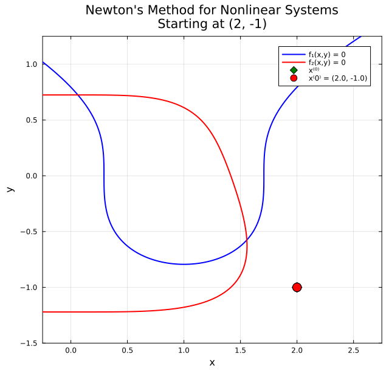

← [Numerical Methods](../)

Source inspiration: [@mathewsSite].

## Description

Many real-world problems require finding a point $(x, y)$ (or a vector $\mathbf{X}$ in higher dimensions) that simultaneously satisfies several nonlinear equations. The general problem is to solve the **nonlinear system**

$$\begin{cases} f(x, y) = 0 \\ g(x, y) = 0 \end{cases}$$

Geometrically, each equation defines a curve in the plane and the solutions are the **points of intersection** of those curves. Two standard iterative strategies extend the scalar root-finding ideas to systems: fixed-point iteration and Newton's method.

### The Jacobian Matrix

Both methods rely on the **Jacobian matrix**, which collects all first-order partial derivatives and describes how small changes in the inputs propagate to changes in the outputs. For a vector function $\mathbf{F}(x,y) = \bigl(f(x,y),\; g(x,y)\bigr)^T$ the Jacobian is

$$J(\mathbf{X}) = \begin{pmatrix} \dfrac{\partial f}{\partial x} & \dfrac{\partial f}{\partial y} \\[8pt] \dfrac{\partial g}{\partial x} & \dfrac{\partial g}{\partial y} \end{pmatrix}.$$

In $n$ dimensions the Jacobian is the $n \times n$ matrix $J_{ij} = \partial F_i / \partial x_j$.

### Fixed-Point Iteration for Systems

Rewrite the system in the form $\mathbf{X} = \mathbf{G}(\mathbf{X})$, i.e.

$$\begin{cases} x = g_1(x, y) \\ y = g_2(x, y) \end{cases}$$

and iterate $\mathbf{X}^{(k+1)} = \mathbf{G}\!\left(\mathbf{X}^{(k)}\right)$ starting from an initial guess $\mathbf{X}^{(0)}$.

**Convergence condition (2D).** If the fixed point $\mathbf{X}^*$ exists and the starting point is sufficiently close to it, the iteration converges provided the row-sum condition holds at $\mathbf{X}^*$:

$$\left|\frac{\partial g_1}{\partial x}\right| + \left|\frac{\partial g_1}{\partial y}\right| < 1 \qquad \text{and} \qquad \left|\frac{\partial g_2}{\partial x}\right| + \left|\frac{\partial g_2}{\partial y}\right| < 1.$$

The row-sum condition is sufficient, not necessary. When it fails, convergence is no longer guaranteed, but the iteration can still converge: from starts sufficiently close to $\mathbf{X}^*$ it converges whenever the spectral radius (the largest eigenvalue magnitude) of the Jacobian of $\mathbf{G}$ at $\mathbf{X}^*$ is less than 1.

### Newton's Method for Nonlinear Systems

Newton's method extends the scalar tangent-line idea by using the Jacobian to linearize $\mathbf{F}$ at the current iterate. Near a point $\mathbf{X}^{(k)}$ we approximate

$$\mathbf{F}\!\left(\mathbf{X}^{(k)} + \Delta\mathbf{X}\right) \approx \mathbf{F}\!\left(\mathbf{X}^{(k)}\right) + J\!\left(\mathbf{X}^{(k)}\right)\,\Delta\mathbf{X} = \mathbf{0}.$$

This linear system is solved for the **Newton step** $\Delta\mathbf{X}$ and the iterate is updated:

$$J\!\left(\mathbf{X}^{(k)}\right)\,\Delta\mathbf{X}^{(k)} = -\mathbf{F}\!\left(\mathbf{X}^{(k)}\right), \qquad \mathbf{X}^{(k+1)} = \mathbf{X}^{(k)} + \Delta\mathbf{X}^{(k)}.$$

The four steps of one Newton iteration are:

1. Evaluate $\mathbf{F}\!\left(\mathbf{X}^{(k)}\right)$.
2. Evaluate the Jacobian $J\!\left(\mathbf{X}^{(k)}\right)$.
3. Solve the linear system $J\,\Delta\mathbf{X} = -\mathbf{F}$ for $\Delta\mathbf{X}$.
4. Set $\mathbf{X}^{(k+1)} = \mathbf{X}^{(k)} + \Delta\mathbf{X}$.

Newton's method converges **quadratically** near a non-singular solution (one where $\det J(\mathbf{X}^*) \neq 0$), meaning the number of correct digits roughly doubles each iteration. If the Jacobian is singular at the solution, the quadratic rate is lost. Because the formulation is dimension-independent, exactly the same algorithm applies in 3D, 10D, or any higher dimension — only the size of the linear system in Step 3 changes.
[Case 1](#case-1) and [Case 2](#case-2) show this rate: at steps 3 to 5, each error divided by the square of the previous one is between $0.51$ and $0.54$ in Case 1 and between $0.92$ and $0.97$ in Case 2.

### Comparison

| Property | Fixed-Point Iteration | Newton's Method |
|---|---|---|
| Convergence rate | Linear when $0 < \rho < 1$, where $\rho$ is the spectral radius of the Jacobian of $\mathbf{G}$ at $\mathbf{X}^*$ (the error eventually shrinks by a factor of about $\rho$ per step); superlinear when $\rho = 0$, as for Newton's method written as a fixed-point iteration, whose $\mathbf{G}$ has zero Jacobian at $\mathbf{X}^*$ | Quadratic |
| Cost per iteration | Low (function evaluations only) | Higher (Jacobian + linear solve) |
| Convergence guarantee | Row-sum condition is sufficient (not necessary) | Requires good starting guess |
| Starting-point sensitivity | High | Moderate |

Newton's method is generally preferred when high accuracy is needed and the Jacobian is cheap to form. Fixed-point iteration is simpler to implement but requires careful formulation of $\mathbf{G}$ to satisfy the convergence condition.
[Newton-Raphson](../newton-raphson-method/) and [Fixed Point Iteration](../fixed-point-iteration/) are the one-equation versions of these methods, [Broyden's Method](../broydens-method/) replaces the Jacobian by an approximation updated from the change in $\mathbf{F}$, and the [Lin-Bairstow Method](../lin-bairstow-method/) is Newton's method in two variables.

## Animations

Each animation below shows the **Newton iteration path in the $xy$-plane** for the system

$$\begin{cases} f_1(x,y) = 1 - 4x + 2x^2 - 2y^3 = 0 \\ f_2(x,y) = -4 + x^4 + 4y + 4y^4 = 0 \end{cases}$$

The blue curve is $f_1 = 0$ and the red curve is $f_2 = 0$. Their two intersections are the solutions. Each frame adds one Newton step: the Jacobian is evaluated at the current point, the linear system $J\,\Delta\mathbf{X} = -\mathbf{F}$ is solved, and the iterate moves to $\mathbf{X}^{(k+1)} = \mathbf{X}^{(k)} + \Delta\mathbf{X}^{(k)}$. Quadratic convergence is a local property, though: the error roughly squares each step only once the iterate is close to an intersection. Over a $301 \times 301$ grid of starting points covering each plot window, more than 90% get within $10^{-10}$ of a solution in at most 10 iterations. Starts near the curve where the Jacobian is singular ($\det J = 0$) can instead be thrown far outside the window and need dozens of iterations to come back, over 200 for the slowest start in each window.

Julia source scripts that generated these animations are linked under each case.

The examples in Mathews' module that are not animated here are fixed-point iteration $\mathbf{X} = \mathbf{G}(\mathbf{X})$ on this same system (Example 1), a check that this fixed-point form and the system above are equivalent (Example 3), Newton's method on this system written as a fixed-point iteration (Example 4) and Newton's method for a system of three equations in three unknowns (Exercise 5).

### Case 1 — Solution 1, starting at $(0.5,\; 0.8)$ {#case-1}

**Behavior:** Starting just above the red curve and well above the blue curve at $x = 0.5$, Newton's method converges rapidly to Solution 1 at approximately $(x^*, y^*) \approx (0.0618,\; 0.7245)$, the intersection in the upper-left portion of the plot. From the start through step 5 the distance to the solution falls $0.44 \to 0.24 \to 0.024 \to 3\times10^{-4} \to 5\times10^{-8} \to 1\times10^{-15}$, each error roughly the square of the previous one (quadratic convergence).

[Julia source](newtonsysaa.jl)

### Case 2 — Solution 2, starting at $(2,\; -1)$ {#case-2}

**Behavior:** Starting in the lower-right region near Solution 2, Newton's method converges to $(x^*, y^*) \approx (1.5561,\; -0.5757)$, the lower-right intersection, where the blue curve crosses the red curve $f_2 = 0$ close to its rightmost point $(1.5579,\; -0.6300)$. Again convergence is quadratic: from the start through step 5 the distance to the solution falls $0.61 \to 0.21 \to 0.034 \to 1.1\times10^{-3} \to 1.1\times10^{-6} \to 1.1\times10^{-12}$, each error roughly the square of the previous one.

[Julia source](newtonsysab.jl)

