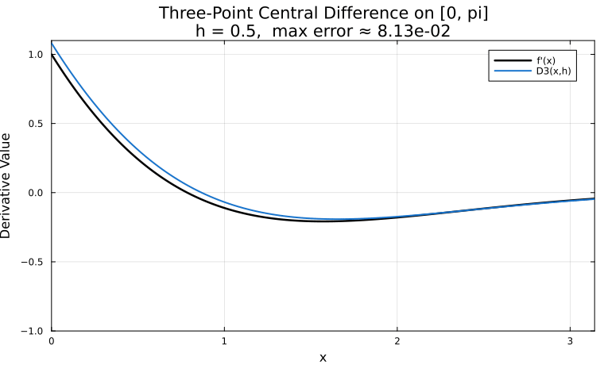

← [Numerical Methods](../)

Source inspiration: [@mathewsSite].

## Description

Numerical differentiation replaces analytic derivatives with finite-difference quotients built from nearby function values. In the Mathews examples for this module, the test function is $f(x)=e^{-x}\sin(x)$ on $[0,\pi]$ with representative steps $h=0.1,0.01,0.001$.
Each formula below differentiates, at $x$, the polynomial that interpolates $f$ at the equally spaced points it uses.

The three-point central approximation for the first derivative is

$$
f'(x) \approx D_3(x,h) = \frac{f(x+h)-f(x-h)}{2h},
$$

with truncation error $O(h^2)$ when $f$ is sufficiently smooth.
When $f$ is known on only one side of $x$, as at the end of a table, the forward ($+$) and backward ($-$) formulas use $x$ and points on that side; the subscript counts the points:

$$
\begin{aligned}
D_2^{+}(x,h) &= \frac{f(x+h)-f(x)}{h}, &
D_3^{+}(x,h) &= \frac{-3f(x)+4f(x+h)-f(x+2h)}{2h}, \\
D_2^{-}(x,h) &= \frac{f(x)-f(x-h)}{h}, &
D_3^{-}(x,h) &= \frac{3f(x)-4f(x-h)+f(x-2h)}{2h}.
\end{aligned}
$$

The three-point central formula for the second derivative is

$$
f''(x) \approx D_3^{(2)}(x,h) = \frac{f(x+h)-2f(x)+f(x-h)}{h^2}.
$$

In general, if the derivative of $f$ in an error term ($f''$, $f'''$ or $f^{(4)}$) is continuous on the interval spanned by the points used, each equation below holds for some $c$ in that interval:

$$
\begin{aligned}
f'(x) &= D_2^{\pm}(x,h) \mp \tfrac{h}{2}\,f''(c), &
f'(x) &= D_3^{\pm}(x,h) + \tfrac{h^2}{3}\,f'''(c), \\
f'(x) &= D_3(x,h) - \tfrac{h^2}{6}\,f'''(c), &
f''(x) &= D_3^{(2)}(x,h) - \tfrac{h^2}{12}\,f^{(4)}(c).
\end{aligned}
$$

So the two-point formulas are $O(h)$ and the three-point formulas are $O(h^2)$, and the central constant $\tfrac16$ is half the one-sided $\tfrac13$.
[Case 1](#case-1) and [Case 2](#case-2) show $D_3$ approaching $f'$ as $h$ falls to $0.001$.
The table follows $x = 1$ down to $h = 10^{-8}$; its entries are the errors $f'(1) - D$ for each first-derivative formula $D$, and $f''(1) - D_3^{(2)}$, in double precision:

| $h$ | $D_2^{+}$ | $D_3^{+}$ | $D_3$ | $D_3^{(2)}$ |
|---|---|---|---|---|
| $10^{-1}$ | $1.82 \times 10^{-2}$ | $3.09 \times 10^{-3}$ | $-1.69 \times 10^{-3}$ | $1.03 \times 10^{-3}$ |
| $10^{-2}$ | $1.97 \times 10^{-3}$ | $3.36 \times 10^{-5}$ | $-1.69 \times 10^{-5}$ | $1.03 \times 10^{-5}$ |
| $10^{-3}$ | $1.99 \times 10^{-4}$ | $3.39 \times 10^{-7}$ | $-1.69 \times 10^{-7}$ | $1.03 \times 10^{-7}$ |
| $10^{-4}$ | $1.99 \times 10^{-5}$ | $3.39 \times 10^{-9}$ | $-1.69 \times 10^{-9}$ | $3.11 \times 10^{-9}$ |
| $10^{-8}$ | $3.30 \times 10^{-9}$ | $3.30 \times 10^{-9}$ | $5.22 \times 10^{-10}$ | $1.58 \times 10^{-1}$ |

Each tenfold cut in $h$ divides the $O(h)$ error by about $10$ and the $O(h^2)$ errors by about $100$, until roundoff takes over.
Down to $h = 10^{-4}$, the backward formulas' errors are within about $20\%$ of these, and that of $D_2^-$ has the opposite sign.

As $h$ decreases, truncation error improves, but eventually roundoff and cancellation can limit accuracy.
For small $h$, $f(x \pm h)$ and $f(x)$ share leading digits that cancel in the difference, and the rounding error of each value, of order $\varepsilon\,|f(x)|$ with $\varepsilon \approx 2.2 \times 10^{-16}$, is divided by $h$, or by $h^2$ in $D_3^{(2)}$.
At $x = 1$, among powers of ten, $D_2^+$ is most accurate at $h = 10^{-8}$, $D_3$ at $h = 10^{-5}$ (error of order $10^{-11}$), and $D_3^{(2)}$ at $h = 10^{-4}$; at $h = 10^{-8}$ the error of $D_3^{(2)}$ is $40\%$ of $|f''(1)|$.
Errors in measured data are magnified in the same way.

[Derive Numerical Differentiation Formulae](../derive-numerical-differentiation-formulae/) derives central formulas from Taylor expansions, [Richardson Extrapolation](../richardson-extrapolation/) combines $D_3(x,h)$ and $D_3(x,h/2)$ into an $O(h^4)$ estimate, [Big "O" Truncation Error](../big-o-truncation-error/) explains the order notation, and the [Finite Difference Method for ODE's](../finite-difference-method-for-odes/) applies central differences to boundary value problems.

## Animations

Each animation below shows finite-difference derivative behavior for $f(x)=e^{-x}\sin(x)$ on legacy interval settings from the source module.

Case 1 extends Example 2(c) of Mathews' module, the plot of $D_3(x,h)$ against $f'(x)$ on $[0,\pi]$, from the single step $h=0.01$ to a sequence of steps, and Case 2 follows Examples 11 and 14, the central difference at $x_0=1$. The module's other examples are not animated here: in Project I, the graph of $f'''$ used to bound the error (Example 1), the tables of approximations (Examples 2(a) and 2(b)), the plot of the absolute error against the error bound (Example 3) and the study of how the bound shrinks with $h$ (Example 4); the forward- and backward-difference formulas for the first derivative (Examples 9, 10, 12 and 13); and the formulas for the second derivative (Project II, Examples 5–8, and Examples 15–17).

### Case 1 - central derivative profile, $D_3(x,h)$ on $[0,\pi]$ {#case-1}

**Behavior:** The numerical derivative curve approaches $f'(x)$ as $h$ shrinks, consistent with second-order truncation error for the central stencil.

[Julia source](numdiffaa.jl)

### Case 2 - secant to tangent at $x_0=1$, $h \to 0$ {#case-2}

**Behavior:** The slope from the symmetric secant $(f(x_0+h)-f(x_0-h))/(2h)$ converges to the tangent slope $f'(x_0)$ as the stencil contracts. As in Example 14, each frame also draws the parabola through the three stencil points and the line through $(x_0,f(x_0))$ with the secant slope; that slope is the parabola's derivative at $x_0$, so the line touches the parabola there and runs parallel to the chord.

[Julia source](numdiffab.jl)

## Derivation Notes

For smooth $f$, Taylor expansions about $x$ give

$$
f(x\pm h) = f(x) \pm h f'(x) + \frac{h^2}{2}f''(x) \pm \frac{h^3}{6}f^{(3)}(\xi_\pm),
$$

which leads to the central three-point first-derivative rule with error proportional to $h^2$.

