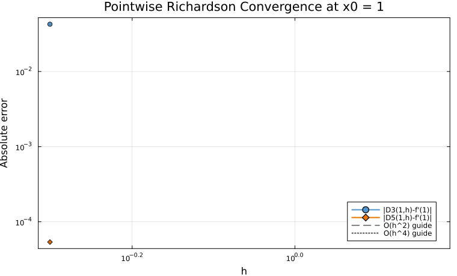

← [Numerical Methods](../)

Source inspiration: [@mathewsSite].

## Description

Richardson extrapolation combines two finite-difference estimates with different step sizes so that the leading truncation term cancels. In the legacy module, this is presented as a refinement of the central three-point derivative for $f(x)=e^{-x}\sin(x)$ over $[0,\pi]$.

Using

$$
D_3(x,h)=\frac{f(x+h)-f(x-h)}{2h},
$$

the Richardson-improved estimate is

$$
D_5(x,h)=\frac{4D_3(x,h/2)-D_3(x,h)}{3},
$$

which upgrades the local truncation behavior from $O(h^2)$ to $O(h^4)$ for smooth functions.

## Animations

Each animation below compares the base central difference with Richardson extrapolation for the legacy test function and interval.
Case 2 plots the error of the estimate in the legacy module's Example 8: $D_5(x,h)$ is that example's five-point formula for $f'$ with spacing $h/2$, evaluated here over a different list of step sizes.
Examples 9–10, which use five-point central-difference formulas to approximate the second and third derivatives at the same point, are not animated here, and neither are the pictures that Examples 8–10 draw: the five stencil points with a line, parabola or cubic through the centre point.
Nor are the module's truncation-error-bound examples: Examples 1, 3, 4 and 5 estimate $M_5=\max|f^{(5)}|$ on $[0,\pi]$ from a graph of $f^{(5)}$, check the resulting five-point error bound against the actual error, show the bound's $O(h^4)$ scaling, and compare it with the three-point bound; Case 1 annotates the actual maximum errors instead.
Example 7, the module's worked extrapolation, combines $D_3(1,0.02)$ and $D_3(1,0.01)$ into the five-point value at spacing $0.01$, which is $D_5(1,0.02)$; its error is the $h=0.02$ point of Case 2 and is not shown separately, and Example 2(b)'s plot of the five-point formula at spacing $0.01$ over $[0,\pi]$ is the $h=0.02$ frame of Case 1.
Example 2(a)'s table at $x=0,1,2,3$ and Example 6's proof that the five-point formula at spacing $h$ equals $\frac{4D_3(x,h)-D_3(x,2h)}{3}$ are not animated either.

### Case 1 - profile comparison, $D_3(x,h)$ vs. $D_5(x,h)$

**Behavior:** Both approximations converge as $h$ shrinks, but the Richardson curve tracks $f'(x)$ much more closely because the dominant $h^2$ error term is canceled.

[Julia source](richexaa.jl)

### Case 2 - pointwise convergence at $x_0=1$ on log-log axes

**Behavior:** The error slope for the three-point formula follows approximately $O(h^2)$, while Richardson extrapolation follows approximately $O(h^4)$ before roundoff effects appear.

[Julia source](richexab.jl)

## Derivation Notes

If $D_3(x,h)=f'(x)+C_2 h^2 + C_4 h^4 + \cdots$, then

$$
\frac{4D_3(x,h/2)-D_3(x,h)}{3}
= f'(x) + O(h^4),
$$

because the $C_2 h^2$ contribution cancels exactly.

