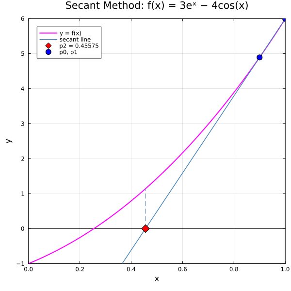
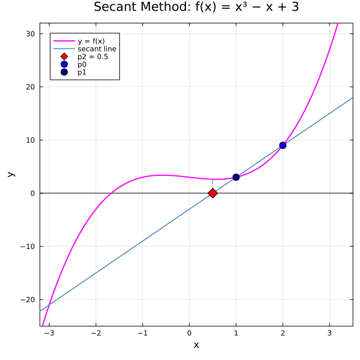
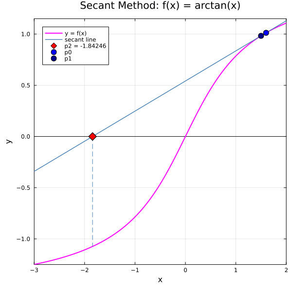

← [Numerical Methods](../)

Source inspiration: [@mathewsSite].

## Description

The secant method solves a single equation $f(x) = 0$ without using the derivative $f'$.
From two starting approximations $p_0$ and $p_1$, each step draws the secant line through the two most recent points $(p_{n-1}, f(p_{n-1}))$ and $(p_n, f(p_n))$ and takes its x-intercept as the next approximation:

$$
p_{n+1} = p_n - \frac{f(p_n)\,(p_n - p_{n-1})}{f(p_n) - f(p_{n-1})}, \qquad n = 1, 2, 3, \ldots
$$

This is Newton's step with $f'(p_n)$ replaced by the slope of the secant line, so each step needs only one new value of $f$.
The formula is the one False Position uses, but the secant method always keeps the two most recent points, so its iterates need not bracket the root.

The step needs $f(p_n) \neq f(p_{n-1})$; otherwise the secant line is horizontal and has no x-intercept.
Mathews' secant theorem gives the guarantee: if $f \in C^2[a, b]$, $f(p) = 0$ for some $p \in [a, b]$, and $f'(p) \neq 0$, then there is a $\delta > 0$ such that the iterates converge to $p$ for starting values $p_0, p_1 \in [p - \delta, p + \delta]$.

In general, write $e_n = p_n - p$.
If the iterates converge to a simple root ($f'(p) \neq 0$) and $f$ is in $C^2$ near it, then

$$
e_{n+1} \approx \frac{f''(p)}{2\,f'(p)}\, e_n\, e_{n-1} \quad \text{for large } n,
$$

and when $f''(p) \neq 0$ this makes the order of convergence $(1+\sqrt5)/2 \approx 1.618$.
Two secant steps cost about as much as one Newton step when $f'$ costs as much as $f$, and together they have order $1.618^2 \approx 2.618$, better than Newton's 2.
In [Case 1](#case-1), $f(x) = 3e^x - 4\cos(x)$ with root $p = 0.254850059029$, the ratio $e_n/(e_{n-1}e_{n-2})$ settles at $f''(p)/\bigl(2f'(p)\bigr) \approx 0.7933$:

| $n$ | $p_n$ | $e_n = p_n - p$ | $e_n/(e_{n-1}e_{n-2})$ |
|---|---|---|---|
| 3 | 0.320730532760 | $6.59 \times 10^{-2}$ | 0.5083 |
| 4 | 0.263760252635 | $8.91 \times 10^{-3}$ | 0.6732 |
| 5 | 0.255293513424 | $4.43 \times 10^{-4}$ | 0.7554 |
| 6 | 0.254853174145 | $3.12 \times 10^{-6}$ | 0.7884 |
| 7 | 0.254850060124 | $1.10 \times 10^{-9}$ | 0.7931 |
| 8 | 0.254850059029 | $2.71 \times 10^{-15}$ | 0.7933 |

When $f''(p) = 0$ the convergence is faster: for $\arctan$ at $p = 0$ ([Case 3](#case-3), [Case 6](#case-6)), $e_{n+1}/(e_n e_{n-1}^2) \to -1/3$ and the order is 2.
At a multiple root, where $f'(p) = 0$, the convergence is only linear.
In [Case 2](#case-2), $f(x) = 25(x - 0.2)^2$, the step reduces exactly to $e_{n+1} = e_n e_{n-1}/(e_n + e_{n-1})$, and $e_{n+1}/e_n$ settles at $(\sqrt5 - 1)/2 \approx 0.618$, slower than Newton's $1/2$ on the same double root.

Convergence is only local.
On $f(x) = xe^{-x}$, starting from $p_0 = 1.5$ and $p_1 = 2$ on the decreasing tail, the secant lines are shallow and the iterates run off to $+\infty$ while $f(p_n) \to 0$, so a stopping test on $|f(p_n)|$ alone would eventually accept a point far from the root ([Case 5](#case-5)).
Even when the iterates converge, the path can be erratic: on $f(x) = x^3 - x + 3$, starting from $p_0 = 2$ and $p_1 = 1$, the iterates wander as far as $3.16$ and $-3.03$ before they converge to the root near $-1.672$ ([Case 4](#case-4)).

[Newton-Raphson](../newton-raphson-method/) uses the tangent line instead, [False Position](../false-position-or-regula-falsi-method/) and [Bisection](../bisection-method/) keep a sign-change bracket, [Muller's Method](../mullers-method/) fits a parabola through the last three iterates, [Brent's Method](../brents-method/) safeguards secant and inverse quadratic interpolation steps with bisection, and [Broyden's Method](../broydens-method/) carries the secant idea to systems of equations.

## Animations

Each animation below shows the **secant diagram** for the Secant Method. At each step, a secant line is drawn through the two most recent iterates $(p_{n-1}, f(p_{n-1}))$ and $(p_n, f(p_n))$; its x-intercept becomes $p_{n+1}$. Unlike Newton's method, no derivative is required — the slope is approximated from two function evaluations. The method can converge quickly, converge slowly near repeated roots, oscillate while converging, or diverge entirely depending on the function and starting points.

Julia source scripts that generated these animations are linked under each case.

### Case 1 — Fast Convergence, $f(x) = 3e^x - 4\cos(x)$, $p_0 = 1.0$, $p_1 = 0.9$ {#case-1}

**Behavior:** The secant method converges quickly to the root near $x \approx 0.2549$. Both starting points are on the same side of the root and the function is well-behaved. The first secant step lands at $p_2 \approx 0.456$, still 0.20 from the root; after that the error falls rapidly (0.066 at $p_3$, 0.0089 at $p_4$, $4.4 \times 10^{-4}$ at $p_5$, $3.1 \times 10^{-6}$ at $p_6$), consistent with the secant method's order $\approx 1.618$ at this simple root.

[Julia source](secantmethodaa.jl)

### Case 2 — Slow Convergence (Double Root), $f(x) = 1 - 10x + 25x^2$, $p_0 = 1.0$, $p_1 = 0.9$ {#case-2}

**Behavior:** The function $(1-5x)^2$ has a double root at $x = 0.2$ where $f'(0.2) = 0$. The secant method converges, but only linearly: here $f(x) = 25(x-0.2)^2$, and the ratio of successive errors settles at $(\sqrt{5}-1)/2 \approx 0.618$, so each step removes only about 38% of the remaining error and the iterates creep toward the root over many iterations.

[Julia source](secantmethodbb.jl)

### Case 3 — Convergence with Oscillation, $f(x) = \arctan(x)$, $p_0 = 1.35$, $p_1 = 1.30$ {#case-3}

**Behavior:** The secant method converges to the root at $x = 0$, but the iterates oscillate — jumping to the opposite side of the root each step before settling. The relatively flat slope of $\arctan$ near the starting points causes the secant line to overshoot to negative $x$ on the first step. The animation ends at $p_8$, which double precision returns as exactly 0: at $p_6 \approx -6.9 \times 10^{-12}$ and $p_7 \approx 4.8 \times 10^{-25}$ the computed $\arctan(x)$ equals $x$, so the secant through them passes through the origin. In exact arithmetic $p_8 \approx -7.6 \times 10^{-48}$.

[Julia source](secantmethodcc.jl)

### Case 4 — Convergence (Oscillating Path to Distant Root), $f(x) = x^3 - x + 3$, $p_0 = 2.0$, $p_1 = 1.0$ {#case-4}

**Behavior:** The cubic $x^3 - x + 3$ has a real root near $x \approx -1.672$. Starting from positive values far from the root, the secant iterates wander — including a large positive excursion — before eventually converging. This case illustrates that convergence can occur even when the path is non-monotone and the starting points are far from the root.

[Julia source](secantmethoddd.jl)

### Case 5 — NON Convergence (Diverging to Infinity), $f(x) = x e^{-x}$, $p_0 = 1.5$, $p_1 = 2.0$ {#case-5}

**Behavior:** Although $f(x) = x e^{-x}$ has a root at $x = 0$, the secant method diverges with these starting points. The function decreases toward zero for large $x$, so the secant line through points on the decaying tail has a shallow negative slope whose x-intercept falls to the right — each step pushes the estimate further from the root. The divergence is slow: after the first jump to $p_2 \approx 4.11$, each step moves right by less than 1 (the step tends to $\ln 2 \approx 0.693$). The animation stops at $p_{10} \approx 10.57$, the first iterate past the right edge of the window; $p_{16} \approx 15.11$.

[Julia source](secantmethodee.jl)

### Case 6 — Convergence, $f(x) = \arctan(x)$, $p_0 = 1.60$, $p_1 = 1.50$ {#case-6}

**Behavior:** With slightly larger starting values than Case 3, the method again converges to $x = 0$. Despite a larger first overshoot, subsequent steps quickly close in on the root. The convergence is super-linear, but because $f''(0) = 0$ for arctan its asymptotic order here is 2 rather than the generic $\approx 1.618$.

[Julia source](secantmethodff.jl)

