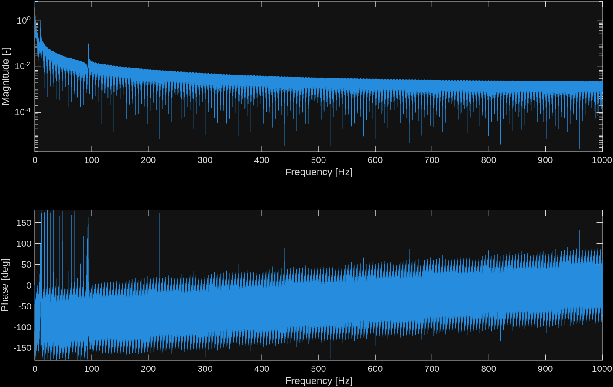

This note provides a practical workflow for computing FFT frequency, magnitude, and phase vectors for double-sided and single-sided spectra, including index formulas for both even and odd `nfft`.

## Problem setup

- A vector `x` with length `L`
- A sample rate `Fs`

## Objectives

- FFT result with chosen `nfft`
- Double-sided frequency, magnitude, and phase vectors
- Single-sided frequency, magnitude, and phase vectors for even `nfft`
- Single-sided frequency, magnitude, and phase vectors for odd `nfft`

## Method

### FFT with `nfft`

Choosing `nfft > L` zero-pads the signal in time domain and decreases the frequency-bin spacing. This improves spectral display resolution.

```matlab
Y = fft(x, nfft);
```

### Double-sided spectrum

#### Frequency

Use frequency resolution $\Delta f = Fs / nfft$.

```matlab
frequencyResolution = Fs/nfft;
frequencyVectorDoubleSided = (0:nfft-1)*frequencyResolution;
```

#### Magnitude

```matlab
magnitudeDoubleSided = abs(Y)./L;
```

#### Phase

```matlab
phase = angle(Y);
```

### Single-sided spectrum (even `nfft`)

#### Frequency

```matlab
frequencyResolution = Fs/nfft;
frequencyVectorSingleSided_even = (0:nfft/2)*frequencyResolution;
```

#### Magnitude

Do not multiply the first element by 2 because it is the DC (mean) term. Scale the remaining terms by 2 to account for the omitted negative-frequency half.

```matlab
magnitudeSingleSided_even = magnitudeDoubleSided(1:nfft/2+1);
magnitudeSingleSided_even(2:end) = 2*magnitudeSingleSided_even(2:end);
```

#### Phase

```matlab
phase_even = angle(Y(1:nfft/2+1));
```

### Single-sided spectrum (odd `nfft`)

#### Frequency

```matlab
frequencyResolution = Fs/nfft;
frequencyVectorSingleSided_odd = (0:(nfft-1)/2)*frequencyResolution;
```

#### Magnitude

Do not multiply the first element by 2 because it is the DC (mean) term. Scale the remaining terms by 2 to account for the omitted negative-frequency half.

```matlab
magnitudeSingleSided_odd = magnitudeDoubleSided(1:(nfft+1)/2);
magnitudeSingleSided_odd(2:end) = 2*magnitudeSingleSided_odd(2:end);
```

#### Phase

```matlab
phase_odd = angle(Y(1:(nfft+1)/2));
```

## Example

This example uses a signal with non-zero mean, one low-frequency sinusoid, and one high-frequency sinusoid.

```matlab
clc; clear; close all;
Fs = 2001; % Hz
time = 0:1/Fs:2;
signalMean = 4;
signalLowFrequencyComponent = sin(2*pi*10*time + 45/180*pi);
signalHighFrequencyComponent = 0.1*cos(2*pi*94*time + pi*30/180);
signal = signalMean + signalLowFrequencyComponent + signalHighFrequencyComponent;
L = length(signal);
```

### Even `nfft` calculations

```matlab
nfft_even = 16384;
Y_even = fft(signal, nfft_even);
magnitudeDoubleSided_even = abs(Y_even)./L;
magnitudeSingleSided_even = magnitudeDoubleSided_even(1:nfft_even/2+1);
magnitudeSingleSided_even(2:end) = 2*magnitudeSingleSided_even(2:end);
frequencyResolution_even = Fs/nfft_even;
frequencyVectorSingleSided_even = (0:nfft_even/2)*frequencyResolution_even;
phase_even = angle(Y_even(1:nfft_even/2+1));

figure
subplot(2,1,1)
semilogy(frequencyVectorSingleSided_even, magnitudeSingleSided_even)
xlabel('Frequency [Hz]')
ylabel('Magnitude [-]')
axis tight

subplot(2,1,2)
plot(frequencyVectorSingleSided_even, phase_even*180/pi)
xlabel('Frequency [Hz]')
ylabel('Phase [deg]')
axis tight
```


### Odd `nfft` calculations

```matlab
nfft_odd = nfft_even + 1;
Y_odd = fft(signal, nfft_odd);
magnitudeDoubleSided_odd = abs(Y_odd)./L;
magnitudeSingleSided_odd = magnitudeDoubleSided_odd(1:(nfft_odd+1)/2);
magnitudeSingleSided_odd(2:end) = 2*magnitudeSingleSided_odd(2:end);
frequencyResolution_odd = Fs/nfft_odd;
frequencyVectorSingleSided_odd = (0:(nfft_odd-1)/2)*frequencyResolution_odd;
phase_odd = angle(Y_odd(1:(nfft_odd+1)/2));

figure
subplot(2,1,1)
semilogy(frequencyVectorSingleSided_odd, magnitudeSingleSided_odd)
xlabel('Frequency [Hz]')
ylabel('Magnitude [-]')
axis tight

subplot(2,1,2)
plot(frequencyVectorSingleSided_odd, phase_odd*180/pi)
xlabel('Frequency [Hz]')
ylabel('Phase [deg]')
axis tight
```


## Summary

Use this sequence each time:

1. Choose `nfft` and compute `Y = fft(x, nfft)`.
2. Build double-sided vectors from `Y`.
3. Build single-sided vectors by selecting half-spectrum and doubling non-DC magnitude terms.
4. Use even/odd indexing formulas that match `nfft` parity.